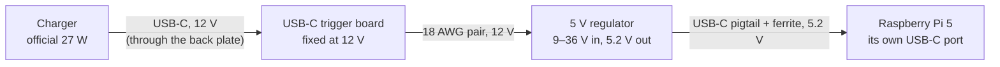

# The power fix: 12 V into the case, 5 V made beside the Pi

Roadmap 5.7, [#53](https://github.com/mferris/StratoScan/issues/53).
**Running on the first unit since 2026-10-17.** In its first minutes, with
the panel lit and both radios on, the Pi got 5.01–5.08 V (5.05 V on
average), with no under-voltage. The 1090 MHz noise floor was unchanged at
−32.4 dBFS, so the regulator adds no noise the receiver can hear. A longer
run's numbers come next.

## Why

The supply reaches the Pi through the back plate's panel-mount USB-C
extension, and at 5 V no extension tried is good enough. The official 27 W
supply plugged straight into the Pi gives 5.06–5.14 V. Through a thin
extension the Pi got 4.96 V, and under-voltage several times an hour.
Through a 5 A / 100 W e-marked one it got 4.66–4.92 V, with 9 under-voltage
warnings in 37 minutes.

The fix asks the supply for 12 V instead, carries that through the case, and
makes 5.2 V right beside the Pi. At 12 V the wires carry less than half the
current, and the regulator takes anything from 9 to 36 V, so the extension's
loss stops mattering.



## Parts

| Part | Notes |
|---|---|
| A charger that offers **12 V** over USB-C PD | The official Raspberry Pi 27 W supply does (12 V at 2.25 A). A 5 V-only charger, such as a Pi-style 5 V 5 A clone, can't power this: the trigger board gets 5 V, and the regulator needs at least 9 V (found on RDU, 2026-10-23). If the label lists no 12 V output, it won't work |
| USB-C PD trigger board, **fixed at 12 V** | 9 V also works with the official supply; 20 V doesn't, because the official supply has no 20 V. A 5 V board is no use here. Most come in packs of several voltages that look alike, so check before wiring (step 1) |
| 5 V step-down regulator: 9–36 V in, 5.2 V out, 6 A at 9–24 V | Wire it from its screw terminals, never its USB socket |
| 18 AWG silicone wire, red and black | About 15 cm of each |
| A **USB-C plug pigtail**: two wires, 20 AWG or thicker, rated 5 A | Or cut one from a USB-C to USB-C cable rated 5 A (sold as 100 W or 240 W), as in step 4. Not a USB-A to USB-C cable: its power wires are thin |
| Snap-on ferrite clip | For the pigtail |
| Heat-shrink, a soldering iron, a multimeter | |
| For the case: a back plate printed since 2026-10-29, and `power_trigger_mount`, `power_trigger_stop` and `power_regulator_tray`, printed (`usbc_gauge` too, to try the fit first); two M3 × 8 button-head screws and two M3 × 3 heat-set inserts; two M2 × 8 screws; VHB tape | In the case folders; see [In the case](#in-the-case) |

The Pi's 5 V pins would also take the regulator's output, but they sit under
the FlyCatcher, so the 5.2 V goes into the Pi's own USB-C port instead.

## Before you start: the Pi's USB current

Powered this way, the Pi can't ask its supply what it offers, so it limits its
USB ports to 600 mA in all. That's too little for the display, which draws
through the Pi's USB, and the receiver's two radios. The installer lifts the
limit with `usb_max_current_enable=1` in `/boot/firmware/config.txt`. Check
that it's there:

```sh
grep usb_max_current_enable /boot/firmware/config.txt
```

Don't use `PSU_MAX_CURRENT` in the EEPROM for this. Writing the EEPROM also
flashes the newest bootloader, and this project never moves the bootloader.

## Build and test on the bench

The Pi isn't involved until step 6.

1. **Check the trigger board.** Plug the charger into it, with nothing on its
   output. The meter on its output pads should read about 12 V. If it reads
   5 V, it's a 5 V board, or a charger without 12 V. Unplug.
2. **Trigger to regulator.** Solder red to the trigger's + pad (sometimes
   VOUT) and black to − (GND), and heat-shrink both joints. Connect the other
   ends to the regulator's input: red to IN+, black to IN−.
3. **Check the regulator.** Plug the charger back in. The regulator's output
   terminals should read 5.1–5.3 V, with + where its label says. Unplug.
4. **Make or check the pigtail.** To cut one from a cable:
   - cut it about 15 cm from the plug (shorter means less loss);
   - strip about 3 cm of the outer jacket;
   - red is 5 V, and black plus the bare braid are ground. If there are two
     reds, twist them together, and twist the blacks with the braid;
   - cut every other wire to about 2 cm, and tape over each one separately.

   Then, with the meter on continuity: black to the plug's metal shell should
   beep, red to the shell should not, and red to black should not. Stop if
   it's any other way: a reversed 5 V wire ruins a Pi.
5. **Regulator to pigtail.** Red to the regulator's OUT+, black and braid to
   OUT−. Heat-shrink the cut end, and snap the ferrite on near the plug.

## Switch the radar over

6. Shut the Pi down: `sudo poweroff`, or ask whoever looks after it.
7. Unplug the supply from the Pi (or the back plate's extension from the
   Pi's port), and plug the pigtail into the Pi's USB-C port.
8. Plug the charger into the trigger board: in the case, straight into its
   socket in the back plate. The Pi starts.
9. Check it:

   ```sh
   vcgencmd pmic_read_adc EXT5V_V        # about 5.1-5.2 V
   vcgencmd get_throttled                # throttled=0x0
   journalctl -k -b | grep -c "Undervoltage detected"   # 0
   lsusb                                 # the display and both radios
   ```

   A switching regulator can add radio noise, so compare the receiver's noise
   floor (`"noise"` in `/run/readsb/stats.json`) with what it was before.

10. **Soak it for an hour** before it goes into the case or leaves the house.
    Keep the display at its normal brightness and the radar on its everyday
    screens. Then run the same checks again: `get_throttled` must still read
    `0x0`, and the kernel must have logged no "Undervoltage detected". The
    dips only show under the full load, so a radar that passes in the first
    minute can still fail here. After that, every health report carries the
    day's count of dips, and the fleet page flags a radar that has any.

A Pi 5 should start from the pigtail's two wires alone. If one doesn't, the
likely missing piece is the 56 kΩ pull-up that USB-A to USB-C cables carry
on their CC wire. A ready-made pigtail sold for powering devices avoids the
question.

## In the case

- **The trigger board's socket goes through the back plate** (since
  2026-10-29). The board's front edge bears on the plate's inner face, and its
  socket goes out through a window its own shape into a pocket in the outer
  face, so the charger's plug meets the socket and goes fully home. Until then
  the socket sat behind the plate, and a plug had to reach it through the
  plate; one whose moulding stopped short of it made a poor connection that
  cut out when the cable moved. `power_trigger_mount` holds the board, and
  `power_trigger_stop` behind it presses it against the plate with no play.
  No extension is needed. To fit them, with the plate outer face down:
  1. Press an M3 × 3 insert into each hole beside the window, from the inner
     face, with the outer face on a flat board, until it stops on the board.
  2. Solder the 12 V pair to the trigger board.
  3. Set the mount on the plate over the window, and screw it on with two
     M3 × 8 button-head screws from inside, into the inserts, a turn short of
     tight.
  4. Drop the board in from the back of the mount, socket first, until its
     socket goes into the window and its front edge rests on the plate.
     Tighten the two M3 screws.
  5. Slide the stop in behind the board until its ribs touch the board.
  6. Drive two M2 × 8 screws through the mount's side walls into the stop:
     they draw it the last 0.3 mm onto the board.

  The plate is what sets the board's place, so the board's front edge must be
  on it before the stop is locked; done on the bench, the socket would rest
  on the bench and the board would end up 2 mm too far back. Try it on
  `usbc_gauge` first, a ten-minute print of the plate round the window: the
  charger's plug must click fully home. Details and checks are in the
  [retro case's README](../enclosure/Retro%20Radar%20Enclosure/README.md#the-power-fix-the-charger-plugs-into-the-trigger-board).
- **The regulator goes in `power_regulator_tray`,** stuck to the plate's
  inner face with VHB tape. Put it as far from the FlyCatcher and the antenna
  leads as the case allows, and where the pigtail reaches the Pi's power
  port, off the 33 × 13.5 mm patch round the window that the trigger board's
  mount stands on. Keep the 5 V side short (a 10–20 cm pigtail), and twist
  the 12 V pair.
- **Never run the regulator's leads along an antenna cable.** On the first
  unit (2026-10-18) its lead had ended up wrapped round the external
  antenna's cable: 1090 MHz reception fell to a few messages a minute,
  against hundreds, and came back as soon as the two were apart.
- **Check the boards first.** The trigger board's size is measured, and the
  regulator's is published. Each part is a short print, so print and fit
  them before the final assembly.
