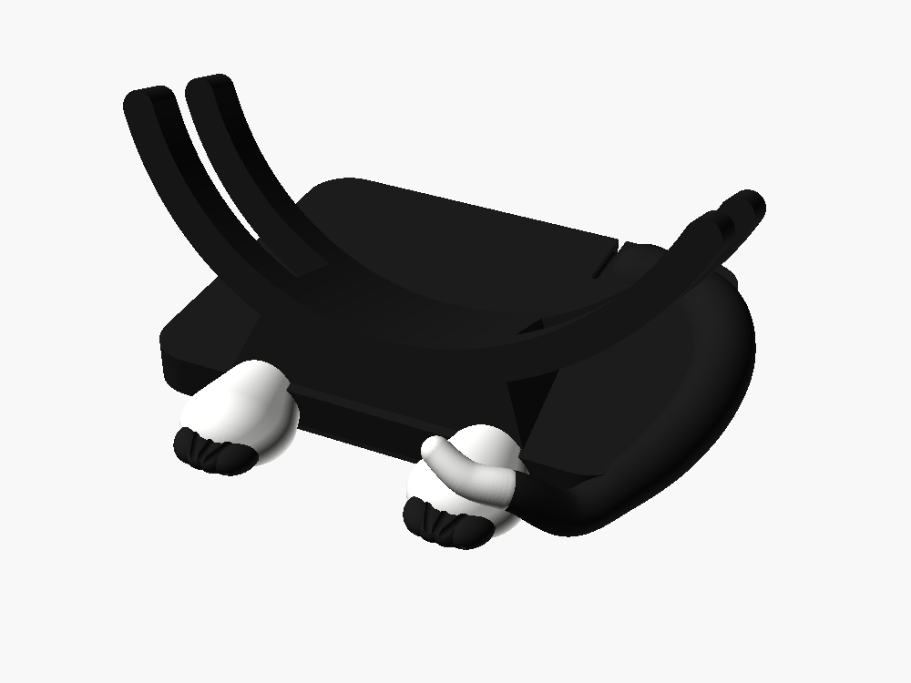

# Kitten enclosure — two-tone

The round display as a cat's face, in two colours: black stand, **white paws
with black toes**, and a **black tail with a white tip**. Ears, whisker-dot
speaker grilles, a nose on the bezel, and a stand with paws and a curled
tail.



Every dimension that touches a physical part comes verbatim from the
[Retro Radar Enclosure](../Retro%20Radar%20Enclosure/), which is printed and
validated: the 203.34mm round panel, the Pi's 58×49 standoff pattern, the two
100×45mm speakers, the 30mm fan, the M3 screw ring, the USB-C and SMA
bulkheads. Only the shape is new, so the two cases are interchangeable on the
same hardware.

This began as a fork of a single-colour kitten design, which has since been
removed — the paws and tail here are about 15% larger than they were in it,
because at two colours they stop being a silhouette detail and become the
thing the eye lands on. `stand.stl` is the whole stand as one piece if you
want it in a single filament.

## Parts

The head is one colour:

| part | colour | what it is |
|---|---|---|
| `shell` | black | the head — body cylinder plus two ears, and all the internals |
| `front_trim` | black | the face — bezel ring with a nose, whisker grooves and seven screw holes. Prints rabbet-down (face up), as `front_trim.stl` is exported, with support (Support for ABS interface) only under the inner band that presses on the glass: the nose stops it printing face down like the retro case's ([below](#the-trim-prints-face-up)) |
| `retainer` | — | ring behind the glass (identical to the retro part), keyed so it goes in only one way: its relief at the bottom, over the gap in the shelf ([below](#so-does-the-retainer)). `retainer.stl` is glass face down, the way it prints |
| `back_plate` | black | removable back — locating lip, vents, the trigger board's USB-C window with a pocket for the plug's moulding and two insert holes for its mount, the charger it needs engraved above it, the antenna mount's bolt holes and cable hole, two insert bosses for the regulator's tray, ten cable-tie bridges for its leads and the coax, and two low curbs that keep the slack of the pigtail and the coax on their own sides; identical to the retro part. Prints outer face down, supports off |
| `back_plate_twotone.3mf` | black + a contrast | the same plate with its charger label in a second colour: one object, the plate on filament 1 and the lettering (`back_plate_text`) on filament 2, built by `make-cover-3mf.py`; identical to the retro part ([below](#the-power-fix-the-charger-plugs-into-the-trigger-board)) |
| `antenna_mount` | black | bolt-on arm carrying the antenna socket |
| `antenna_mount_sma` | alternative mount: same flange, arm and counter-tilt, ending in a panel-mount SMA jack instead of a socket cut for one antenna's base |
| `antenna_mount_twin_8`, `antenna_mount_twin_11` | **the one to print for the FlyCatcher:** same flange and three bolts, ending in a crossbar with two SMA jacks 80 mm apart, for the 1090 and 978 MHz whips; counter-tilted so both stand vertical with their hinges straight. Two styles, for jumpers whose bulkhead body is an 8 mm hex or an 11 mm hex; two parts each, this body and the cover below (`antenna_mount_twin` is whichever `ant_twin_jack_af` names) |
| `antenna_mount_twin_cover_8`, `antenna_mount_twin_cover_11` | the 3 mm cover that closes the twin body's cable channel, on five M2 screws, with each side's frequency engraved in it (`twin_assembled` and `twin_assembled_11` show both parts on the plate, for pictures only) |
| `test_lettering_plate.3mf`, `test_lettering_cover.3mf` | black + a contrast | two-colour test coupons, a 1.2 mm slice of the plate's and the cover's faces round their lettering, about 11 minutes each, identical to the retro's ([below](#lettering-in-two-colours-print-settings)) |
| `usbc_gauge` | — | test coupon: a 36 × 18 mm piece of the back plate round the USB-C window, exactly the plate's, to try the charger's plug in the trigger board before printing a plate |
| `power_trigger_mount` | — | the power fix's 12 V trigger board's mount, with the board's socket through the USB-C window ([below](#the-power-fix-the-charger-plugs-into-the-trigger-board)); identical to the retro part |
| `power_trigger_stop` | — | the block behind the trigger board in its mount, on two M2 screws, keyed so it goes in only the right way round; identical to the retro part. Print three: one for the trial fit on `usbc_gauge`, one for the plate and a spare. Its crush ribs are spent once squeezed, so a stop that comes out is never fitted again |
| `power_regulator_tray` | — | the power fix's 5 V regulator's tray, screwed to two insert bosses at its one place across the bottom of the plate's inner face, a saddle with a cable-tie slot at each open end for the leads, `OUT` and `IN` engraved at its two ends, and a tie groove under each half of its floor (since 2026-10-29); identical to the retro part. Prints floor down, supports off |

The stand is split into five bodies, one per colour region:

| part | colour | what it is |
|---|---|---|
| `stand_body` | **black** | plinth, cradle arms, keel, and a clip beside the tail's root for the charger's cable ([below](#the-stand-holds-the-chargers-cable)) |
| `stand_paws` | **white** | both foot pads |
| `stand_toes` | **black** | the eight toe lobes |
| `stand_claws` | **white** | eight real claws, one per toe |

`kitten-stand-twotone.3mf` is all six of the above in one project file with
the filaments already assigned — the easiest way in, and the one that avoids
the multi-lump selection problem described under *Printing it in two colours*.
| `stand_tail` | **black** | the tail from root to the white tip |
| `stand_tail_tip` | **white** | the flicked-up end |

`stand` is the whole stand as one piece, the same shape in a single
filament — useful if you are not printing in two colours, and it is also the
reference the five coloured parts are checked against.

## The back comes off, and carries the antenna

The back used to be a fixed floor with the electronics standing on it, so the
only way in was through the glass. It is a separate plate now, screwed to
eight insert posts exactly as the faceplate is.

**This plate is the same part as the retro build's**, and so is the antenna
mount. Both cases are the same 223.34mm diameter, use the same eight-post
ring, and lean back by the same 18°. That is checked rather than asserted:
exported from each design, the two back plates are 15,410 facets that compare
equal as sets — the same solid, differing only in triangle order.

A rib on the inner face drops into the bore so the plate lands centred and
square and holds itself there while the screws go in, with a 1.2mm chamfer on
its outer top edge so it finds its own centre. It is eight arcs rather than a
ring: the insert posts span r=102.2–111.2 against a bore wall at
r=108.7–111.7, so they straddle the wall and a continuous ring would run
through all eight. Three checks hold it — `lip_present` as a positive
control, `lip_clears_posts`, and `lip_inside_bore`, since a lip larger than
the bore does not locate anything, it just stops the plate seating.

The two cable glands are gone, replaced by a single USB-C opening; the
antenna's coax comes in through the mount's own bore instead. **Since
2026-10-29 the opening is the 12 V trigger board's own**: a window the shape
of its socket, a 14 × 10 mm pocket round it in the outer face for the plug's
moulding, and two insert holes for the board's mount (see the power fix,
below). It took a panel-mount USB-C extension until then, in an 11 × 8 mm
window with two M3 holes 16.5 mm apart; that extension doesn't fit this
plate. Print `usbc_gauge`, the 36 × 18 mm piece of the plate round the
window, to try the board and the charger's plug before committing a plate.

The mount screws into three M3 heat-set inserts on the plate's inner face
rather than through bare holes, so it can be removed without holding a nut
inside the case. The insert pocket stops on a shoulder 1mm above the plate so
the insert cannot be pressed too deep. The bolt circle is clocked 30° off
vertical for clearance, not looks: at 0° one boss reaches y=106.5, into the
locating lip at 106.3.

The upper vent moved from y=+68 to y=−68. The mount's flange is a 40mm disc
centred at y=88 (y=81 since 2026-10-07), so at +68 the grille sat underneath it from y=68 to y=81,
venting into the back of a solid disc — which is what prompted this.
`vents_clear_of_mount` holds the new position, and `vents_were_under_mount`
is its paired control, finding the overlap the old one had (487 mm³ with the
flange at y=81). On 2026-10-29 the low vent moved again, with the owner's OK,
up to (6, −46), just under the central one: the bottom of the plate is the
regulator's tray's now (see the retro case's README,
[The regulator's place](../Retro%20Radar%20Enclosure/README.md#the-regulators-place)).
It keeps its 19 holes, so the same area of intake, but 22 mm higher, so its
air has that much less height to rise through the head, and nothing now lets
air in below the regulator. The nearest holes of the two vents are 10.1 mm
apart, centre to centre, 7 mm of plate between them. The Pi's temperatures
were measured with the vent at the bottom: measure them, and the regulator's,
again once a unit is built this way. The 12 V pair crosses the low vent on
the decks of two tie bridges, 4.4 mm off the plate, so its holes stay open.

The Pi is mounted to the LCD panel, so taking the plate off exposes the back
of the Pi and its cabling rather than removing it. The four 58×49 Pi
standoffs the plate used to carry were never used and are gone (2026-10-07;
`pi_posts()` keeps their geometry). **There is no fan mount** — the fan goes on the Pi. The two grille
patterns stay as plain vents.

The antenna mounts on the back of the plate rather than on a turret, since a
turret out of a cat's skull is a spike. It is a **bolt-on**: three M3 bolts
on a 30mm circle. That keeps both parts flat and support-free on the bed, and
lets the antenna angle change later without reprinting the tray. The cable
drops out of the socket and runs straight through the arm, the flange and the
plate into the case.

The mount sits inside the head's outline and cannot be seen from the front;
only the antenna shows, rising between the ears.

### Why the arm reaches straight back before the barrel rises

The arm goes **back** from the plate, and only then does a barrel rise from
its end along the antenna's own axis. That two-stage shape is forced, not
styled. A barrel coaxial with the antenna and rooted on the plate would have
to climb toward the head the whole way and would run into it.

The first attempt avoided that by hulling a pad on the plate to a disc at the
socket — which produced a *cone* with the socket bored into its flank, so the
antenna pointed sideways and down rather than up. A stub plus a barrel gives
a real cylindrical socket with a flat face square to the antenna.

The arm is 30mm because that is what the clearance costs. Swept against the
antenna's own envelope: at 22mm it fouls the head's top rim even at nominal
diameter, at 26mm it clears nominal but not +2mm, and at 30mm it still clears
with 6mm of radial slack. `antenna_clears_head` holds it.

## The plate fits one way only

The plate's locating rib is eight identical arcs between eight evenly
spaced posts, so it used to seat at any of eight positions 45° apart, and
only one of them puts the antenna mount at the top. A small block on the
shell's bore wall at 247.5° (lower right seen from behind, between the posts at 225° and 270°)
now meets a matching notch in one arc of the rib: upright, the plate drops
in; turned to any other position, the block lands on the rib and the plate
stands proud before a screw goes in. It sits well clear of the antenna-mount
bosses at the top and the USB-C window, and both shells put it at the same
angle, so the one plate still fits both cases.

`key_fits` proves the upright plate meets the block with no volume, and
`key_blocks_45` … `key_blocks_315` prove each of the other seven positions
collides (43.7 mm³ each), each as its own check, because a key that blocked
only some angles would still let the plate in wrong.

## So does the retainer

The retainer's relief has to be at the bottom, over the display's driver
board, which is taped to the back of the glass; the other seven of the eight
ways its screw notches allow put solid ring under the board. Since
2026-10-29 a 2 mm tab on its back face, at 250-258° and outboard of the
glass, drops into the gap in the shelf at the bottom only when the relief is
there too; anywhere else it lands on the shelf and holds the ring 2 mm proud
before a screw goes in. So: **relief at the bottom, over the gap in the
shelf.** `retainer.stl` is glass face down, the way it prints, with the tab
standing up. `retainer_key_fits` and `retainer_key_blocks_45` …
`retainer_key_blocks_315` hold it, as for the plate (125.9 mm³ each).

**Check it is the right way up before the glass goes on (2026-10-30).** The
tab faces the shelf, away from you as you fit the ring from the front. Seated
the right way up and round, the ring lies flat with its relief at the
bottom, and from the front no tab shows anywhere. If you can see a 2 mm tab
standing up off the ring's front face, it is upside down: take it out and
turn it over. Flatness alone doesn't prove it: upside down, the tab is on
the glass's side, so the ring lies flat on the shelf in all eight positions,
and in seven of them solid ring sits under the driver board. Once the glass
and trim are on, the only sign is the trim standing about 2 mm proud at one
spot, over the tab; if it does, take the trim and glass off and turn the
ring over. `retainer_flipped_meets_trim` holds that sign: the ring upside
down, under the glass and trim, runs into the trim (about 126 mm³).

**Check the leads before fitting a keyed ring.** The tab hangs 2 mm into the
shelf's gap, the channel left for the display's cabling, at 250-258° and
r 102.7-107 mm, between the glass's edge and the wall, so a display cable or
speaker lead running through there would be pinched under it. No built unit
has been checked for one yet (2026-10-29). If one has to run there, move the
tab instead: set `retainer_key_a` to another 8° of the gap (245-295°), clear
of the lead and at least 3° from the screw at 270°, in this design and the
retro case's, since the retainer is shared; re-export `retainer.stl` in both
case folders; and re-run `retainer_key_fits` and `retainer_key_blocks_45` …
`retainer_key_blocks_315`, which must still find all seven wrong positions
blocked.

## The trim prints face up

The retro case's trim prints face down, flat on the bed, with nothing to
support. This one can't: the nose stands 2.6 mm proud of the face, so face
down the trim would stand on its nose, with the whole face printed on
support. So it prints rabbet-down, face up, the way `front_trim.stl` is
exported. The outer band, the rabbet round the glass's edge, is then the
first 1.62 mm on the bed, and the inner band, the 4 mm that presses on the
glass, starts 1.62 mm up, over air: 2,505 mm² of it. Support it there and
nowhere else, with Support for ABS as the interface, as the mounts print: it
comes away clean and leaves the band's underside flat, to sit evenly on the
glass. Nothing else on the trim needs support, so tree supports on auto find
only that band.

Sliced on 2026-10-29 in Bambu Studio 2.08 (X1C 0.4 mm, 0.20 mm Standard,
Bambu ASA, tree supports at 30°), it takes 1.7 cm³ of support, all of it
under the inner band, and prints in 1.1 hours (27 g). Face down it would take
9.2 cm³ and 2.0 hours, with the face printed on it.

## Less support inside the head

The same three changes as the retro case, which has the details
(2026-10-29), all in the shared internals:

- the shelf's underside slopes at 45° from r 103 out to the wall, except over
  the speakers, over 30-75° and in the shelf's gap at the bottom. Where an
  ear's hollow opens into the head it stops wherever the hollow comes up past
  z 49, since the wall below the shelf is gone there and the slope would start
  in mid-air; since the ears' tops are tented (below), that is nowhere;
- over each speaker, the sleeve's top wall reaches up to the shelf, closing
  the 2 mm slot between them;
- the front rail has the retro rings' 45° underside and 0.8 mm lip; the rear
  rail, which bears on the rear arm, stays square.

Sliced in Bambu Studio 2.08 (X1C 0.4 mm, 0.20 mm Standard, Bambu ASA, tree
supports at 30°), the head's support went from 58.4 to 49.7 cm³ and the print
from 10.0 to 9.2 hours. `shelf_slope_present`, `speaker_slot_closed` (with
`speaker_slot_probe_works`), `rail_slope_present`, `rail_lip_kept` and
`rear_rail_square` (with `rear_rail_probe_works`) hold it, and
`head_in_cradle` still finds the head clear of the stand.

Where an ear's hollow opens into the head, the kitten's shell cuts the
hollow out of the shared slope. Today that cut removes nothing, so the
shelf is still the retro case's; `slope_clear_of_ears` must come out empty,
so a later change to the ears that would bite into the slope fails a check
instead of quietly giving the kitten a different shelf (2026-10-30). Two
changes that would take more support out of both shells are left for a
later print: see the retro case's README,
[For a later shell print](../Retro%20Radar%20Enclosure/README.md#for-a-later-shell-print).

### The ears: tented tops, and wall under the two posts in them

Two more changes, to the kitten's own ears (2026-10-29):

- **The ears' hollows have 45° tented tops.** Each hollow had a flat roof at
  z 53, 4,550 mm² in all, printed on 53 mm-tall supports inside the ears. Now
  every side of the hollow slopes inward at 45° from z 28, so its top comes to
  a point at z 53: nothing in the ears is flat, so nothing there needs
  support. The plastic it adds prints as infill, and comes to less than the
  support it saves. It shows only from behind, looking up into an ear.
- **The head wall stands under the front posts at 45° and 135°.** The
  hollows cut the wall away from the back collar (z 11) up to z 53, and those
  two posts are inside the openings, so each hung free from the shelf: its
  cone's tip was an island 45 mm above the bed, joined to nothing until z 53.
  The wall is now kept from the edge of each ear's opening to 3° past its
  post, the whole height, so the cone lands on wall growing from the collar,
  as on the retro case. As on every post, the cone's lowest 1.5 mm still
  begins 2 mm in from the wall, in mid-air: a tiny island
  ([Heat-set inserts](#heat-set-inserts)).
  (3° past the post rather than either side of it: the
  opening's edge is only 5° beyond the post, and a strip either side would
  leave a slit 2-4 mm wide.)

Together they take the head's support from 49.7 to 33.7 cm³, the print from
9.2 to 8.1 hours and the filament from 200 to 193 g: all 13.2 cm³ of support
inside the ears goes, and round the two posts it is now what every other post
has. The ears' openings into the head shrink from 6,260 to 3,680 mm², which
leaves the airflow as it was: it is set by the back plate's vents, 608 mm²,
and the ears' open backs, 3,833 mm², are unchanged.

`front_posts_on_wall` must come out empty: the wall behind every front post,
over its cone and the post below the shelf (z 45-53), is all there, and
behind the two in the ears all the way down to the collar (the old head lacks
1,554 mm³ of it). `post_wall_probe_works` is its control: the same probe
behind the 90° post, which always stood on wall, finds it (160 mm³).

## Printing it in two colours

The five stand bodies share one coordinate frame, so they occupy their true
positions relative to each other. That gives you two routes:

**Multi-material (AMS, MMU, tool changer).** Open
`kitten-stand-twotone.3mf`. It is the whole stand as one object with the six
bodies already inside it and a filament already assigned to each — nothing to
position, nothing to select.

That file exists because loading the STLs separately does not work well, for
a reason that is not obvious. Three of the bodies are physically several
disconnected lumps: two paws, two clumps of toes, and eight separate claws,
because that is what the shapes are. Slicers split a multi-lump mesh into
separate parts on import, so picking a filament for "the claws" colours **one
claw** and leaves the other seven — which looks like the tool ignoring you.
There is no way to fix that from the STL side; eight claws cannot be one
connected lump. So the assignment lives in the project file instead.

The filament slots are 1 for the black (body, toes, tail) and 2 for the white
(paws, tail tip and claws). The claws had slot 3 to themselves until
2026-10-29, so they could be a third colour; on the paws' white the print
needs one filament change fewer in each of the 29 layers they are in. For a
third colour, pick another filament for them in the slicer, or set
`stand_claws` to 3 in `make-3mf.py`. Change any of them in the slicer.

If you would rather load the STLs by hand anyway: load the first, then "add
part"/"load as part" for the rest, which preserves their positions, and
assign a filament to each.

**Support.** Everything on the stand starts on the bed (2026-10-29). The
claws used to stop 1.2 mm short of the desk and the toes 0.47 mm, so each
began in mid-air; now both come down onto it, level with the pads' flat
bottoms. The tail lies on the desk until it reaches the right paw, sunk
1.2 mm so its sides need nothing, and climbs at about 40° beside the paw,
which prints on its own; it used to rise off the desk well before the paw and
cross about 25 mm of air, 3-14 mm up. Over the paw it is as it was: it rises
off the pad and the tip flicks up, so that part still wants a little support,
and so do the rounded undersides of the toes and claws, in tiny supports
under 2 mm tall at the bed, and the clefts between the toes where they run
in under the pads. Sliced in Bambu Studio 2.08 (X1C 0.4 mm, 0.20 mm Standard,
Bambu ASA, tree supports at 30°), the one-piece stand's support went from
3.3 to 2.1 cm³ and the print from 5.8 to 5.6 hours; the 0.9 cm³ that held up
the tail before the paw is gone.

**Single extruder.** Print them as separate objects and glue. Every split
follows a real seam in the shape — pad to toe, tail to tip — so the joins
land where the eye already expects a line. Print `stand_body` flat on its
base; the paws, toes and tail parts are all small and sit stably on their cut
faces.

### Why the parts overlap slightly

The bodies deliberately interfere by 0.3mm (`colour_overlap`) along every
seam, and the first version of this design got that exactly backwards.

Cutting each part with the precise shape of its neighbour is the tidy answer
and it is the broken one. It produces a perfect partition — zero shared
volume — while leaving the two bodies sharing a *surface* at identical
coordinates. No renderer can decide which of two faces at the same depth is
in front, so the slicer stipples the seam with the other colour: a white paw
arrives speckled black, worst over the buried half of the paw where the
shared area is largest.

So each part is cut with a slightly inset copy of whatever takes precedence
over it, leaving a thin shell of shared material instead of a shared surface.
Nothing is coplanar, and the colour boundary moves by at most 0.15mm — a
fifth of a nozzle width, so which body a slicer awards the shell to cannot be
seen in the print.

The tail needed the opposite treatment. Its two parts are runs of the same
tapering tube, so wherever they overlap they carry the same outer skin —
and an overlap of identical skin is the very coincidence being avoided.
There the tip is grown rather than the body shrunk, so over the shared
stretch the white tip sits 0.15mm proud of the black tail it continues.

## The whisker grooves

Three short arcs engraved into the bezel face either side of the nose.

They were briefly in the wrong place, and it is worth recording how. The
nose sits at −y, the bottom of the face; the grooves were rotated about 0°
instead — the right-hand side — so all six landed 90° from the nose they
were meant to flank. That printed before anyone noticed, as six unexplained
indentations down one side of a faceplate.

They are now placed off `nose_angle` rather than a literal, and each sweeps
away from the nose so the two sides mirror. `whisker_off_nose` in
`checks.scad` pins it: the grooves must lie entirely within a 90° wedge
centred on where `nose()` actually puts itself. That wedge is written as a
literal 270 on purpose — deriving it from `nose_angle` would make the check
vacuous, since moving the angle would move the wedge along with the grooves.

## Where the colour goes, and why

- **Paws white, toes black.** The toes are the detail that makes a paw read
  as a paw, and they are small — they need the contrast more than the pad
  does. The clefts between them grew with the toes; the groove is the only
  thing making four toes read as four rather than one lumpy pad.
- **Claws are their own body, and they are real geometry.** The grooves
  between the toes were being read as the nails; they were never that — they
  are the only thing making four toes read as four. There are now eight
  actual claws, one off the front of each toe, following that toe's splay and
  drooping toward the desk the way a cat's does. Their base sits *inside* the
  toe rather than butted against it: a spike joined at a tangent point is a
  weak spot in the print, and a butted joint would share a surface with the
  toe, which is the coincidence that stipples the preview. The tip comes down
  onto the desk, cut flat there like the pads (2026-10-29). It used to stop
  clear of it, so the claws would not carry the stand and rock, but the pads
  are flat on the desk too, so claws level with them carry nothing, and held
  off, each began in mid-air on a first layer of 1 mm². `claws_stand_proud`
  is a positive control: a claw entirely buried in its toe passes every seam
  and volume check while being invisible on the print, which is exactly what
  the grooves-as-nails problem looked like.
- **Tail black, tip white, and the tip lifts.** The first version had the tip
  resting flat on the pad, which is what a sitting cat does — but that put a
  white tip on top of a white paw, where it vanished. The whole point of a
  white tip is that it reads against what surrounds it. Lifted, it is
  silhouetted from every angle, and a flicked tail tip is cat-like anyway.
  This was caught by rendering it and looking, not by any check.

## Smoothness

Curve resolution is set by `$fs` (0.4mm) and `$fa` (0.5°) in the `.scad`,
not by a fixed facet count.

A fixed count was what this had, and it makes the flats grow with the
feature — so the biggest, most looked-at surfaces come out roughest. At the
old `$fn = 96` the head's 223mm rim carried **7.3mm flats** and the cradle
8.2mm, while every 3mm screw hole also got 96 sides it had no use for. `$fs`
caps the chord — the width of one flat, which is what the eye reads as
faceting — so a large curve gets the facets and a small hole does not. The
head is now at 0.97mm and every sphere in the paws, toes and tail at 0.4mm,
which is one extrusion width: below that a 0.4mm nozzle cannot reproduce the
difference.

The meshes are exported as **binary STL**. At this resolution the stand is
173,000 facets, which is 52MB as ascii and 8.3MB as binary for byte-identical
geometry. Every slicer reads both.

`tail_smooth_steps` is the other half of it. The tail is hulls between
consecutive spheres, so every sphere leaves a crease running around the
tube. At the old resolution those creases were masked by the general
faceting; once the circumference was smooth they read as rings. 14 points
per control segment puts a joint every 2.4mm instead of 5.6mm, for about a
megabyte.

To go finer, lower `$fs` — but check the file sizes, because sphere cost
grows as the square.

**`use <>` does not carry `$fa`/`$fs`.** It imports modules and functions
only, so `checks.scad` and the preview files set them again at the top. Miss
that and they silently render at OpenSCAD's defaults, showing a faceting the
exported mesh does not have — or, worse, validating geometry that is not what
gets printed.

## Seven screws, not eight

The bezel has seven screw holes. There is an eighth insert post in the shell
at the same angle as the nose, and the nose stands on top of it — 2.6mm of
solid capping the hole, so that screw could never have been fitted. Rather
than leave a hole that cannot take a screw and reads as a moulding defect
under the chin, it is not cut at all.

The shell keeps all eight posts. An unused boss is invisible from outside and
keeps that part identical to the retro build it was copied from.

Found by probing the screw ring after a faceplate had already been printed.
`nose_screw_removed` now proves the hole is absent, and `other_screws_present`
is its paired positive control — an empty result from the first would also be
what a probe in the wrong place produces, so a probe at a normal position has
to find a real hole for the pair to mean anything.

## Lettering in two colours: print settings

The back plate's charger label, the twin antenna covers' frequencies and the
Retro with Dials' control arc are inlaid in a second colour, and each part
prints face down, so its letters are its first three layers (2026-10-31).
The first two-colour arc printed with broken letters: SCREEN's C almost gone,
STATUS's S half there, and a pale ring round each word. Its strokes were
0.5 mm wide, about one first-layer line, and Bambu Studio's default classic
walls leave out a stroke too narrow for two of them. Sliced with the
defaults, the old lettering's first layer is thin and patchy in its narrow
strokes, the C and S among them. What caused the pale ring is not yet known;
print a coupon (below) to see whether these settings cure it.

Two things changed. The lettering is larger and bolder, with every stroke at
least 1.0 mm wide and every counter and gap between letters at least 0.8 mm
open (`tests/test_enclosure_core.py` measures them, check 13). And the
first three settings below go on the part, set by hand once the 3MF is
open: Arachne walls, elephant-foot compensation 0 and a monotonic line
bottom surface. For a few hours on 2026-10-31 the 3MFs carried them as
per-object settings, but Bambu Studio's desktop app then opened the files
as geometry only ("The 3mf file has invalid config"), losing the filaments,
so the 3MFs now hold only the parts and their filaments. Sliced with the
settings, the first layer now lays two lines or more across most of each
stroke, and one wider Arachne line, up to 0.7 mm, across most of the rest. Arachne walls and the larger lettering
are what fill the first layer.

**Print a coupon first.** `test_lettering_plate.3mf` and
`test_lettering_cover.3mf` (here and in the Retro folder) and
`test_lettering_arc.3mf` (Retro with Dials) are 1.2 mm slices of the faces
round their lettering, cut from the parts themselves. Each prints in about
11 to 12 minutes on an X1C, against 25 minutes for a cover, 52 for the arc
and 2 h 40 min for the plate. When a coupon's letters come out whole with
clean edges, its part will too.

The settings, with their names in Bambu Studio 2.08 and the keys in its own
profiles. Set the first three on the object (right-click it in the object
list, then Process, and add them under Quality and Strength) or, with only
the face on the plate, in the print settings; the 3MF does not set them.

| Setting | Where | Value | Key | Who sets it |
|---|---|---|---|---|
| Wall generator | Quality | Arachne | `wall_generator` | you, per object or for the plate |
| Elephant foot compensation | Quality > Precision | 0: keeps the face's outer edge from being pulled in 0.15 mm; it does not touch the lettering | `elefant_foot_compensation` | you, per object or for the plate |
| Bottom surface pattern | Strength | Monotonic line | `bottom_surface_pattern` = `monotonicline` | you, per object or for the plate |
| First layer line width | Quality > Line width | 0.42 mm | `initial_layer_line_width` | you, in the print settings |
| First layer speed, and first layer infill | Speed | 30 to 40 mm/s | `initial_layer_speed`, `initial_layer_infill_speed` | you, in the print settings |
| Prime tower | Others | on (the default) | `enable_prime_tower` | you, in the print settings |
| Z-hop | Printer > Extruder | 0.4 mm, Auto Lift (the X1C's default) | `z_hop`, `z_hop_types`; a filament can override it with `filament_z_hop` | the printer |
| Plate | the plate's type | Smooth PEI ("Smooth PEI Plate / High Temp Plate"), clean, preferred over the Engineering plate for a face | `curr_bed_type` | you |
| Filament | | dry ASA: 65 °C for 12 h, or 80 °C for 8 h where the dryer allows it (Bambu's ASA profile) | | you |

What slicing with Bambu Studio 2.08's command line showed:

- Bambu Studio honours the first three settings per object. With Arachne
  alone, the old cover's first layer laid down much more of its lettering.
- Elephant-foot compensation acts only on a part's outside edge, not on the
  edge the two colours share. Sliced with it at 0.15 and at 0, the
  lettering's first layer came out the same, and only the face's outline
  grew 0.15 mm a side. It is off so the face's edge prints true.
- Set per object, first-layer line width and speed did nothing. They work
  only as print settings, so set them there.
- A first-layer width of 0.42 instead of 0.5 hardly changed the coverage:
  90 to 94% either way. It lays a third line in more of the wider strokes,
  at the cost of more short lines under 0.4 mm. Arachne's walls do the
  work.
- The slow first layer and the Z-hop keep the nozzle from catching the
  first layer's edges. The gouge beside the SCREEN hole on the first arc
  looks like that kind of drag. Wet ASA strings and blobs on those travels.
- The prime tower takes each colour change's purge, three changes on the
  way up and one back to filament 1, off the part.

## The power fix: the charger plugs into the trigger board

The same three parts as the retro case, since they fit the shared back plate.
Since 2026-10-29 the 12 V trigger board's socket goes through the plate: the
board's front edge bears on the plate's inner face, its socket goes out
through a window its own shape, and a plug's moulding goes into the pocket
round it to meet the socket, so the plug goes fully home.
`power_trigger_mount` holds the board there, on two M3 × 8 button-head
screws from inside the case into two M3 × 3 inserts in the plate, with two
crush ribs along its roof that press the socket down so the board cannot
rock, and `power_trigger_stop`, behind the board on two M2 × 8 screws through
the mount's walls, presses it forward with no play. The stop is keyed: a
ridge along one bottom edge at its back end runs in a slot in the mount's
wall, so it goes in only the right way round. Drive its M2 screws snug, not
hard: past seating they strip their thread in the mount's wall, and the
slack comes back. A trial fit on `usbc_gauge` spends two M3 × 3 inserts,
which stay in the coupon, and one stop's crush ribs, so the plate needs two
more inserts and a fresh stop. A stop is good for one fitting: whenever one
comes out, to re-seat the board or to move the mount across, a fresh one
goes in, and a test with a refitted one proves nothing. The pocket's floor
prints as a bridge in two steps, which you can see in the pocket: a slot
right across it, then the window's rectangle, then the window; slice with
counterbore hole bridging off, the default. Above the pocket the plate says
which charger the board needs, `USB-C PD 12V 27W`, engraved in its outer
face so it reads from behind the case. For the label in a second colour
(since 2026-10-31), print `back_plate_twotone.3mf` instead of
`back_plate.stl`: one object, the plate on filament 1 and the lettering on
filament 2, which wants a colour that stands out from the plate's. Supports
off, outer face down as always; the colours change only in the first three
layers, 0.6 mm, the lettering filling the engraving exactly (the retro
README has the slice; the settings and a ten-minute coupon are in
[lettering in two colours](#lettering-in-two-colours-print-settings)). `power_regulator_tray` holds
the 5 V regulator at its one place across the bottom of the plate's inner
face (since 2026-10-29), screwed down with two M3 × 8 button-head screws
into M3 × 5 inserts in two bosses on the plate, with a saddle and a cable-tie
slot at each open end, so every lead is tied just past its ferrule, and
clear of the 70 × 13.5 mm strip across the window, where the mount stands and
the M2 screwdriver goes in from either side. `OUT` and `IN` are engraved at
the tray's two ends. Its pocket and saddles are drawn for the first unit's
regulator, measured on 2026-10-30: a 63.5 × 27.25 mm board, its leads
leaving the terminals 2 mm over it, and nothing past its ends, so each lead
runs straight from its terminal to its tie; measure the board's thickness,
which isn't measured yet, before printing. Ten bridges and two curbs on the
plate hold the leads and the coax apart, seen from behind: the 12 V pair from
the trigger board (lower left) across the lower half of the plate, over the
top of the low vent and round the tray's right-hand end to the regulator's input; the
pigtail from its output at the left-hand end up the left side of the Pi and
along its top edge, between the Pi and its curb, to the Pi's USB-C port (upper right);
and the coax from the cable hole down the right-hand side, between its curb
and the speaker, to the FlyCatcher's SMA jacks. Every power lead is 20 mm
or more from the coax and the SMA plugs but at one place, the Pi's own: its
USB-C socket is 11 mm from the FlyCatcher's right-hand edge, so the
pigtail's plug and its drop to the plate, 3 to 4 cm of cable, come within
20 mm of where an SMA plug could be, the plug's moulding 8 mm from it.
Fitting, sizes and checks are in the retro case's README
([The power fix](../Retro%20Radar%20Enclosure/README.md#the-power-fix-the-charger-plugs-into-the-trigger-board)
and [The regulator's place](../Retro%20Radar%20Enclosure/README.md#the-regulators-place)),
and the build in [docs/power-fix.md](../../docs/power-fix.md).

### The stand holds the charger's cable

Nothing held the cable, so its weight and every tug levered the plug in the
trigger board's socket, and a moving cable is what set off the power cuts.
The plug points straight back from the window, 18° down; its end is about
69 mm above the desk, and the cable drops from it onto the back of the
plinth, where the tail's root is. A clip takes it there (2026-10-29): the
retro case's clip, the same groove for the same cable, along the root's
inboard foot at x = 41.4, 18 mm inboard of the plug. Not under the plug
itself: the root is solid from the desk up there, so a groove under it would
be a tunnel no plug can be threaded through, and a way in cut down through it
would split the tail.

- **A groove along the plinth's top**, from level with the root's front
  (y 44) to the back edge, round and 0.2 mm under the cable, so it grips,
  with a mouth 0.7 mm narrower than the cable, so it snaps in and stays. The
  cable lies just under the top face.
- **Over the back edge** the groove turns down round a 4 mm radius, so the
  cable bends round a curve rather than over an edge, still behind the mouth.
- **Down the back face** a channel as wide as the groove, open to the back,
  so the cable hangs flat to the back and leaves it wherever it bends away
  along the desk.

To fit the cable, plug it in with the case in the stand and leave a slack
loop of 40-50 mm between the plug and the clip, so a pull on the cable moves
the stand before it reaches the plug. Press the cable into the groove from
its front end back, round the edge, and let it hang down the channel. **Take
the cable out of the clip before lifting the case out of the stand:** the
loop is too short for the case to come out with the cable still in it.

The clip is sized for a cable about 4 mm thick (`stand_cable_d`). Measure
yours before printing the stand: a thinner one won't grip, and a thicker one
won't go in. Set `stand_cable_d` to it in four places: this design, the
retro case's design, and the `checks.scad` in both folders (the core test
holds all four to one cable, as the cable is one). Or print `test_clip`, the
clip in a 20 × 37 mm piece of the plinth's back, and try the cable in that
first. The clip needs no support.

`stand_clip_takes_cable` must come out empty: a cable 3.6 mm across passes
all the way along the groove, round the turn and down the back with nothing
in its way (the stand as it was finds 399 mm³). `stand_clip_grips` and
`stand_clip_snaps` are its controls: a 4 mm cable is squeezed along the top
and round the turn (31 mm³), and lifted 1 mm out of the groove it still meets
the mouth's lips (19 mm³).

## Heat-set inserts

Every screw that gets undone goes into a brass M3 heat-set insert. The holes are sized for the Kadrick M2–M5 kit: its M3 inserts are 4.5 mm across the knurl and 3.9 mm at the lead-in. Every insert hole is **4.0 mm**, so the lead-in drops in square and the knurl melts 0.25 mm a side into the plastic. (They were 4.2, which left a 4.5 mm insert only 0.15 mm of bite.)

| Where | Count | Insert | Screw | Notes |
|---|---|---|---|---|
| Front posts in the shell (front trim and retainer screw into these) | 8 posts, 7 used | M3 × 5 | M3 × 14 | Pressed from the front, flush with the shelf the retainer sits on |
| Back posts in the shell (back plate screws into these) | 8 | M3 × 6 | M3 × 8 | Pressed from the back face, flush |
| Antenna mount flange | 3 | M3 × 5 | M3 × 8 | The pocket is in the mount; the screws come from inside the case, through the back plate |
| Back plate, beside the USB-C window (the trigger board's mount screws into these) | 2 | M3 × 3 | M3 × 8 button head | Pressed from the inner face with the outer face on a flat board, so each ends flush with both faces; the screws come from inside the case, through the mount's ears (since 2026-10-29) |
| Back plate, the regulator tray's two bosses | 2 | M3 × 5 | M3 × 8 button head | Pressed from the top of each boss, flush with it; the holes stop 2 mm short of the outer face. The screws go down through the tray's two caps (since 2026-10-29) |
| `usbc_gauge`, for the trial fit before the plate | 2 | M3 × 3 | the mount's own two M3 × 8 | Pressed the same way. They stay in the coupon, so the plate needs two of its own |
| Twin antenna mount's cover | 5 | M2 × 3 | M2 × 6 | 3.0 mm holes in the cover seat (for a 3.2 mm knurl; 3.2 if the kit's inserts are the 3.5 mm kind — measure them). No counterbores: a 3 mm cover printed face-down can't roof them, so the cap heads stand 2 mm proud of a face nothing touches |
| Speaker bosses (optional) | 8 | M2 × 3 | M2 × 6 | The 2.6 mm pilot takes the speaker's self-tapping screws; drill it to 3.0 for an M2 insert |

**The front posts are new.** They used to be only 2 mm tall: an insert sat in 2 mm of plastic with open air under it and the wall on one side only (measured: a third of the ring round it was solid). Now each post hangs 8 mm below the shelf, merged into the wall, with a 45° cone under it that lands on the wall below. The two at 45° and 135° are inside the ears' openings, where until 2026-10-29 the wall was cut away below the shelf, so they hung free from it; the wall now stands under them too ([above](#the-ears-tented-tops-and-wall-under-the-two-posts-in-them)). Not quite all of each cone is on the wall, though (2026-10-30): it is centred 2 mm inside the bore, so it meets the wall only from z 46.5 up, and its lowest 1.5 mm, from its 1 mm tip at z 45, is a small island in mid-air. The slicer grows one small tree from the bed to each of the eight tips, about 0.5 cm³ of support a shell in all. Harmless so far; the retro case's README has the change a later shell print could make ([For a later shell print](../Retro%20Radar%20Enclosure/README.md#for-a-later-shell-print)). The holes are cut after the whole shell is unioned, so the speaker brackets at 0° and 180° can't fill them.

- `front_inserts_surrounded` proves every front insert has a 1.75 mm ring of plastic all round it for its full length. Run against the old shell, it finds 545 mm³ missing.
- `front_insert_holes_open` is its positive control.
- `front_posts_on_wall` proves the wall behind every post is there under its cone, and under the two in the ears all the way down to the back collar; `post_wall_probe_works` is its control.

The kitten's bezel has seven screws (see *Seven screws, not eight*). The post under the nose needs no insert.

**Pressing them:** a soldering iron with an M3 insert tip, at about 220 °C for PLA or 245 °C for PETG.
1. Start the insert square in the hole.
2. Let it sink under its own weight plus light pressure. Don't push hard.
3. Stop when it is flush.
4. Hold a flat, cool piece of metal on it for a few seconds while the plastic sets, so it stays square.

### The twin mount: 1090 and 978 MHz

The FlyCatcher has two antenna inputs, 1090 and 978 MHz, and the Nooelec bundle has a hinged whip for each. `antenna_mount_twin` holds both.
- **Same base as the others:** the flange and three bolts, so nothing else changes.
- **A crossbar** with a bulkhead jack at each end, 80 mm apart. Antennas this close in frequency detune each other when bunched together.
- **Counter-tilted,** like the single mounts, so the whips stand vertical with their hinges straight. Hinges hold firmly only at their stops, and part-way they sag over time.

**Cables:** two SMA male to SMA female bulkhead jumpers, RG316, about 40 cm (16") (SMA, not RP-SMA): a bulkhead end has a threaded barrel with a nut and washer, which is what holds the antenna. 40 cm since 2026-10-29: inside the case each takes 18 to 21 cm, its route down the right-hand side and the slack to ease the plate back, and a 30 cm one gives only about 18 cm once the mount has its share. The small right-angle pigtails in the antenna bundle are MCX, for Nooelec's USB sticks, and aren't used.

**Whip or external antenna, the user's choice:** each tower's jack is an ordinary SMA socket on the outside of the case. Screw on the Nooelec whip, or the coax from an antenna mounted outside or in a window; nothing inside changes. An outdoor antenna with an N-type connector needs an N-male to SMA-male cable. Leave the FlyCatcher's bias-tee switch off unless the outdoor antenna has a powered amplifier that needs it.

**Two parts since 2026-10-07: a body and a flat cover.** The first version ran each cable through an internal tunnel and could not be assembled: both ends of a jumper are rigid metal about 9 mm across and 15–20 mm long, and that cannot turn a right-angle corner inside an 11 mm bore. The checks had only ever passed a straight probe down each leg. Now the crossbar and towers have an open channel on the side away from the case, closed by a cover on five M2 screws, so everything is laid in and nothing is threaded round a corner. The arm's bore runs straight on through the crossbar and out of the channel floor; it is 13 mm, and so is the plate's hole, because both plugs share it and the second has to pass the first cable. Under each tower's panel is a slot that is a close fit on the jack's hex body, so the jack cannot turn while its nut is tightened. The panel is 2 mm: the bulkhead's thread is 10 mm from its shoulder, and 2 of panel, 0.6 of washer and 2.5 of nut leave 4.9 mm for the whip's own coupling nut.

**The plate's cable hole grew from 11 to 13 mm the same day.** A back plate printed before that — including one printed from the y=81 plate committed earlier on 2026-10-07 — will not pass the second plug and must be reprinted.

**Two styles, by the jumper's bulkhead body.** Measure the body behind the shoulder across its flats: the jumpers on hand come as 8 mm and as 11 mm hexes, and `antenna_mount_twin_8` / `antenna_mount_twin_11` (with their covers) are cut for each — slot = flats + 0.8, a pocket the hex's size under the panel, the tower, bar and cover sized to suit. Both take the same 6.35 mm barrel. Any other size is one number: `antenna_mount_twin([9, 9])`, or a mixed pair. A round body has nothing for the slot to hold; the jack is then held with thin pliers through the open channel while its nut goes on, before the cover.

**Which side is which:** the cover carries each tower's frequency, engraved under it and read from behind the case — `1090` on the left, `978` on the right (`ant_twin_labels`; `ant_twin_label_on = false` for a plain cover). The 1090 whip is the shorter one.

**Printing:** body flange-down with tree supports (Bambu Support for ABS interface), as the other mounts print. The towers and bar have 6 mm corners and rounded edges, like the cases, rather than a box. The channel, slots, insert holes and jack holes all face up or sideways and need nothing; the towers' outboard ends and the bar's top edge start in mid-air, so the supports go on the face toward the case, where nobody sees the scars. Cover flat, counterbored face down, no support. ASA on a clean Engineering plate, no glue.

**Fitting the cables** (cover off, body held channel-up — or the flange hanging over the bench edge, since the plugs come out of its underside). First mark the two jumpers at both ends, so they can't be swapped later: one band of heat-shrink on the 1090 one, two on the 978 one (2026-10-29).
1. Push each plug end into the bore at the centre of the channel, straight down the arm and out through the flange — the second plug goes in beside the first cable with a wiggle. Pull each cable through beyond the bore's mouth as far as it goes once the mount has its share, about 28 cm of a 40 cm jumper (it was 10 cm until 2026-10-29). Inside the case the route takes 15 to 19 cm to the jack, depending on how low the jack is on the FlyCatcher's edge, and 2 to 3 cm more is the slack that lets the plate come back 5 cm before the plugs are undone; the rest lies in the jumpers' free run (step 5). A 30 cm jumper gives only about 18 cm: keep one only if, with the plate held 5 cm back, its plug still reaches its jack.
2. Lay one cable along the channel to each tower. Hold the jack's hex body with the barrel pointing up its tower and slide it sideways into the open slot until it stops.
3. Push the jack up with a fingertip through the open channel: the top of the slot is a closed pocket the hex's size, and the barrel comes through the panel when the body is in it. Washer and nut on from the top, finger tight, then a quarter turn with an 8 mm (5/16") spanner — the pocket holds the jack, so nothing inside has to be held. Don't crank it; the panel is 2 mm of ASA. Check the nuts again after a week; ASA relaxes a little.
   Set each whip so its hinge folds towards or away from the wall, not towards the other whip: that's the direction the mount is weakest, so the hinge gives before the panel does, and a folded whip then clears the other tower.
4. Tidy the cables into the channel and fit the cover: five M2 × 6 into the M2 inserts.
5. Pass both plugs through the plate's 13 mm hole, bolt the flange on from inside the plate with the three M3 × 8, plug 1090 and 978 into the FlyCatcher, and screw the whips on (the 1090 whip is the shorter one). Inside, tie both jumpers together at the two bridges that lead from the cable hole to the right and down the right-hand side, seen from behind, with 150 × 3.6 mm cable ties. Below the second bridge they run free down the right-hand side, between their curb and the speaker, to the FlyCatcher: fold any spare length back on itself just below the second bridge and take it into that bridge's tie, so only the planned slack runs on to the SMA plugs, on the speaker's side of the curb, never across it. Never leave the spare as a loose loop: the plate stands nearly upright, and a loop that sags below the SMA plugs comes within 20 mm of the 12 V pair at the lower right (since 2026-10-29; [the regulator's place](../Retro%20Radar%20Enclosure/README.md#the-regulators-place)). That keeps them 20 mm or more from the regulator's leads, which keep to the lower half and the left, and from the Pi's USB-C plug. For an outdoor antenna, screw its coax onto the same barrel instead, and give the coax its own strain relief within a few centimetres of the tower.

To replace a cable: back plate off, cover off, nut off, slide the jack out of its slot, pull the plug back up through the bore. The mount stays bolted to the plate.

**Checks:**
- `twin_bore_straight`: a plug beside a cable (12 mm) passes straight down the 13 mm bore from the flange face to below the crossbar.
- `twin_slot_takes_jack`: an 8 mm-across-flats hex body stands in each slot under its panel.
- `twin_cover_fits`: the cover sits in its seat without touching the body; `twin_cover_seats` (control) finds the body when the cover is pushed 2 mm in. `twin_channel_open` and `twin_cover_screws_open` (controls) find a rod along the channel and rods through the cover's holes whole, and `twin_channel_probe_clear` and `twin_screw_probes_clear` are their complements: the same rods meet no body at all.
- `top_screw_clear_of_twin`: the plate's top screw and a hex key clear the mount.
- `twin_antennas_clear_case`: both whips, swept 220 mm up, miss the case (and the kitten's ears); `twin_antennas_probe_works` (control): the same envelopes moved 60 mm down the axis and 40 mm toward the case do hit it.
- `twin_vs_plate`, `twin_vs_stand`: no collisions with the back plate or the stand.
- `twin_panels_present`, `twin_holes_open`: positive controls; the panels are there and the jack holes are open.

## Checks

`sh run-checks.sh` runs every target in `checks.scad` and reports the
**volume** each produces.

Volume, not facet count. A boolean between parts that touch leaves
zero-thickness films along the boundary — thousands of facets and no volume —
so counting facets calls a correct model broken. The threshold is 1mm³
against a paw of roughly 27,000mm³, and a real interference has nowhere to
hide in that gap.

Volume alone is not enough either, which is what the speckled first version
proved: a shared surface has no volume at all. That is what
`check-coincident.py` below is for.

Alongside the fit checks on the head and cradle, the colour split adds:

- `material_lost` — must be **zero**: a region of the one-piece stand that no
  coloured part claims. That would print as a hole.
- `material_gained`, `paws_vs_toes`, `body_vs_paws`, `tail_vs_tip` — must be
  **small but non-zero**: these are the colour seams, and zero here means the
  parts share surfaces instead of overlapping, which is the speckling bug.
  Bounded at 1500mm³, which is 0.15mm of thickness over 10,000mm² of shared
  surface — far more than these parts have.
- `power_ribs_squeeze_board`, `power_top_ribs_squeeze_socket` — must be a
  sliver, and `power_board_cannot_rock` more than a film: the power fix's
  crush ribs in its trigger board, and the board, tipped 1°, meeting them
  (the retro case's README has the power fix's checks).
- `power_stop_back_to_front_blocked`, `power_stop_upside_down_blocked`,
  `power_stop_end_over_end_blocked` — must run into the mount: the trigger
  board's stop the wrong way round, as far in as a screw could start in it.
- `power_stop_slides_home`, `power_stop_key_is_what_blocks` — must meet
  nothing at all, under 0.01 mm³ rather than 1: the same stop slid home the
  right way round, and back to front without its key. A jam there is a
  sliver, so `power_stop_jam_probe_works`, the key's slot begun 0.5 mm
  late, must be found (0.13 mm³).
- `front_stack_seats` — must be empty: the retainer, glass and trim, placed
  by `front_stack_placed()` as the preview places them, meet the head with no
  volume. `front_stack_retainer_down` and `front_stack_trim_down` must find
  real geometry: lowered 0.2 mm, the retainer runs into the shelf and the
  trim into the rim, so neither stands off the head. (The preview drew the
  retainer inside the shelf until 2026-10-29.)
- `tail_on_the_desk` — must be empty: under the tail's middle, from the
  plinth's side to beside the right paw, the first three layers on the desk
  are solid, so it lies on the desk all that way (the old stand finds
  40 mm³ of air there). `tail_probe_works`, its control, is the same probes
  further on, under its climb, where they find the air (20 mm³).
- `canary` — must produce geometry. Without it, a typo in the `use <>` path
  makes every check above pass against nothing, which has happened here
  before.

`check-coincident.py` makes the check the volume tests cannot: it compares
the exported meshes face by face and counts triangles two parts have at
identical coordinates. Two parts sharing a surface have zero shared volume
and still stipple, so nothing about that bug is visible in a volume
measurement. All fifteen pairs must come out at zero. With the overlap disabled
(`-D colour_overlap=0`) the same check reports 3,502 shared faces between the
paws and the toes, which is precisely the speckling. It also counts each
body's separate lumps, and since 2026-10-29 checks that every lump of the
body, paws, toes, claws and tail starts on the bed: a lump whose lowest point
is above it begins in mid-air, which no volume check sees. The old claws
start 1.24 mm up and the old toes 0.47 mm.

Run everything with `sh run-checks.sh`, which also runs the coincidence
check.

## Regenerating

```sh
for p in shell front_trim retainer stand back_plate usbc_gauge \
           power_trigger_mount power_trigger_stop power_regulator_tray \
           antenna_mount antenna_mount_sma antenna_mount_twin_8 antenna_mount_twin_11 \
           antenna_mount_twin_cover_8 antenna_mount_twin_cover_11 \
           antenna_mount_twin_cover_text_8 antenna_mount_twin_cover_text_11 back_plate_text \
           test_lettering_plate test_lettering_plate_text test_lettering_cover test_lettering_cover_text \
           stand_body stand_paws stand_toes stand_claws stand_tail stand_tail_tip; do
  openscad --backend=manifold --export-format binstl \
           -D "part=\"$p\"" -o "$p.stl" kitten-enclosure-twotone.scad
done
python3 make-3mf.py   # kitten-stand-twotone.3mf, from the six stand_* meshes
python3 make-cover-3mf.py   # the covers', the back plate's and the coupons' two-colour 3MFs (test check 12 fails until they are rebuilt)
```

**The exporter is not deterministic.** Two consecutive exports of unchanged
source differ — 135 facets out of 210,448 on the stand, and even the facet
count moves (210,758 vs 210,448 across runs). It shows up on the stand and
not on the simple parts, which is consistent with it coming from the hundreds
of hulls the paws and tail are built from. Two consequences: re-exporting
everything makes the stand files show as modified whether or not anything
changed, so only re-export what actually changed; and comparing two STLs byte
for byte is not a test of whether they are the same shape — compare the
triangle sets instead.

The `.stl` files are committed alongside the source so the folder is
self-contained, but they are generated. Change the `.scad` and both must be
re-exported and committed together, or the mesh quietly stops matching the
source it claims to come from.

OpenSCAD's `manifold` line on an export is not the slicer's check
(2026-10-29). Where two solids in a part only touch, along a line or a face,
instead of overlapping, the export still says manifold, and Bambu Studio
reports non-manifold edges and reversed faces when it opens it.
`python3 tests/test_enclosure_core.py` checks every print file's edges as a
slicer does, so run it after an export.

### The connector has to fit through, not just the cable

The bore was 9mm and the coax **connector** is 9.15mm across its widest
point, so it did not pass at all. Worse, the straight bore is cut along the
plate's normal while the socket above it is tilted by `stand_angle`, so the
two were not coaxial and the socket floor met the bore at an angle — leaving
a shoulder across the opening for the antenna's base to land on. Widening the
bore alone would not have removed that; it is a consequence of the two axes
disagreeing.

The socket floor is now opened square to the **antenna's** axis and hulled
down onto the straight run, so there is one continuous passage with no step
anywhere across it. `connector_passes` sweeps a 9.15mm plug gauge along that
path and must touch nothing; `connector_gauge_works` is its paired control,
an oversized gauge that must be caught. Swept by hand the passage clears
10.5mm and blocks at 11.0mm, so the connector has 1.35mm of margin.

Note for anyone tuning this: `-D` on the command line reaches `echo` but not
the CSG tree for these files, so a gauge sweep driven by `-D` silently
measures the file's own value at every step and reports that everything
passes. Edit the number instead.

### The antenna socket, and the lip that holds the base

The socket was Ø33 and a printed mount would not take the antenna at all: the
base is a flared cone slightly wider than that where it has to pass, so it
never got under the rim. It perched on top and tipped over — while the cable
underneath ran through perfectly, which is the part that had been checked.

Then the second printed one had its **rim snap off** while a base was being
levered under it, which says the approach was wrong and not just the number.
A 2mm chamfer left 2.5mm of wall at the edge, and a printed rim that thin,
pried outwards across its layer lines, is weak. Stiffness goes as thickness
cubed, so the barrel went 45 → 48 and the chamfer 2 → 1.2mm: 4.8mm of wall at
the edge, roughly seven times stiffer.

The deeper point is that **the base is held by depth, not by an overhang**.
The socket is 8mm deep, the antenna sits down inside it, and the chamfer is a
lead-in for a base that is already smaller than the hole — not a ramp for
forcing an oversized one past. If it has to be levered, the socket is too
small; make it bigger rather than pushing harder.

### What was actually stopping it, after three wrong guesses

The base measures **31.25mm across its flared bottom**, and **the lead leaves
the SIDE of the base 7.98mm above it** — both measured. The original socket was
Ø33, already 1.75mm of clearance, so *the bore was never what stopped it*, and
three attempts to fix the bore were fixing the wrong thing: that the base was
wider than the hole, that it was a cone flaring above a narrow bottom, that
the connector needed room beneath. None of them were true.

With the base seated, the lead is 7.98mm above the socket floor — and it
cannot go down through that floor, because the base is sitting on it. It has
to leave sideways. The printed mount gave it nowhere to go, so the connector
ended up jammed in the notch where the cable passage happens to break through
the wall, holding the base up at an angle. That notch was an accident of the
geometry; there is now a deliberate slot, 7mm wide, running from the floor up
past the rim.

It faces local +Y in the antenna's frame, which works out to world
(0, +0.309, −0.951) — down and back toward the plate — so the lead drops
straight into the passage that was already there instead of being led around
the barrel. `cable_slot_open` checks a rod at the measured exit height passes
out through the wall, and `cable_slot_other_side` is its control: the same rod
on the far side must be blocked, or "the slot is open" would be
indistinguishable from "the probe missed the mount".

`socket_takes_base` holds it, with `socket_gauge_works` as its paired control.
Its first version was wrong in a way worth recording: it ran a full-diameter
disc 12mm into the air above the mouth and failed at 283mm³, which was the
arm alongside. A 35mm cylinder held 12mm above the socket really does overlap
the arm — and means nothing, because the base is a cone that narrows and comes
in from outside. The question is whether the base fits the socket.

## Two antenna mounts, and which to print

`antenna_mount` holds the antenna itself: a 33mm socket cut around the
FlightAware desktop puck's 31.25mm base, with a slot for the lead that leaves
the side 7.98mm up. It fits that antenna beautifully and nothing else, which
makes the case choose the antenna.

`antenna_mount_sma` inverts that. Same flange, same three bolts into the same
inserts, same counter-tilt -- only the far end changes, to a panel-mount SMA
jack. Anything with an SMA plug now works: the same puck, a tuned whip
standing straight off the back, or coax running to an antenna somewhere with
a view of the sky. Swapping it is three screws; the back plate and both
shells are untouched.

Print the SMA one unless you specifically want the puck held on the case.
Measured on this hardware, an indoor puck saw **1 aircraft** while a properly
sited antenna saw **14 of the same sky at the same moment** -- so the ability
to put the antenna somewhere else is worth more than any mount that holds it
here.

The counter-tilt is the part not to touch. ADS-B is vertically polarised, and
`ant_axis_frame()` is what keeps the jack vertical while the case leans back
18 degrees in its cradle.

Four things are checked rather than assumed, and the interesting one is
`sma_passage_joins`: the cavity behind the jack has to actually meet the
cable bore, or the jack threads into a sealed pocket and the coax has nowhere
to go. That failure is invisible in preview -- both volumes are cut, the part
looks hollow, and the wall between them only exists in the print.
