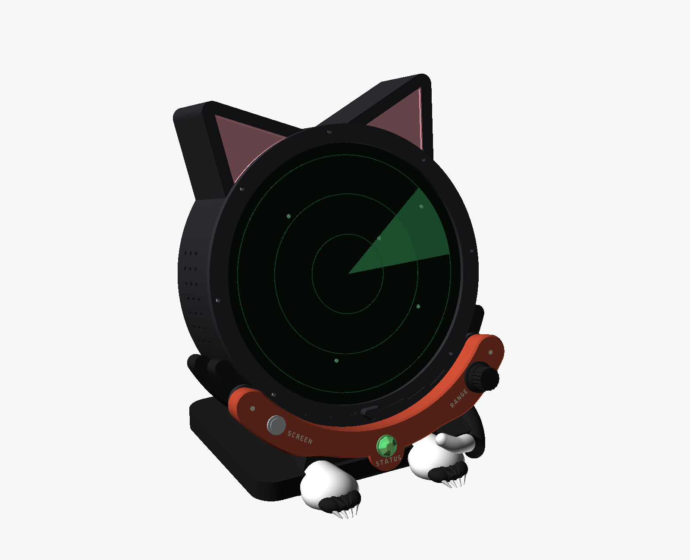
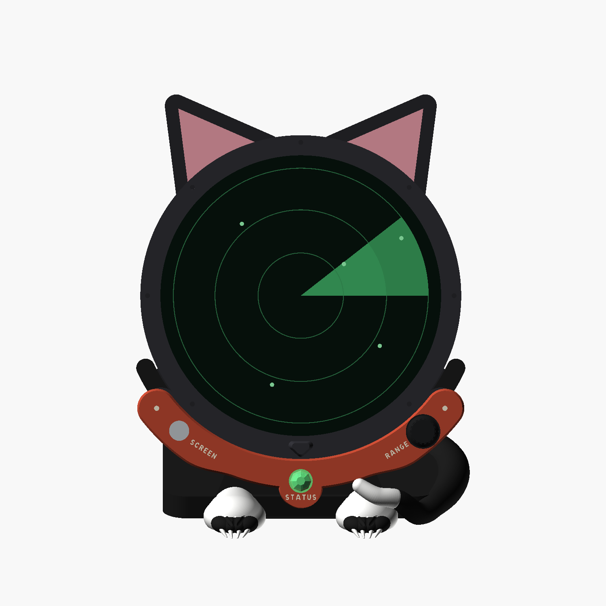
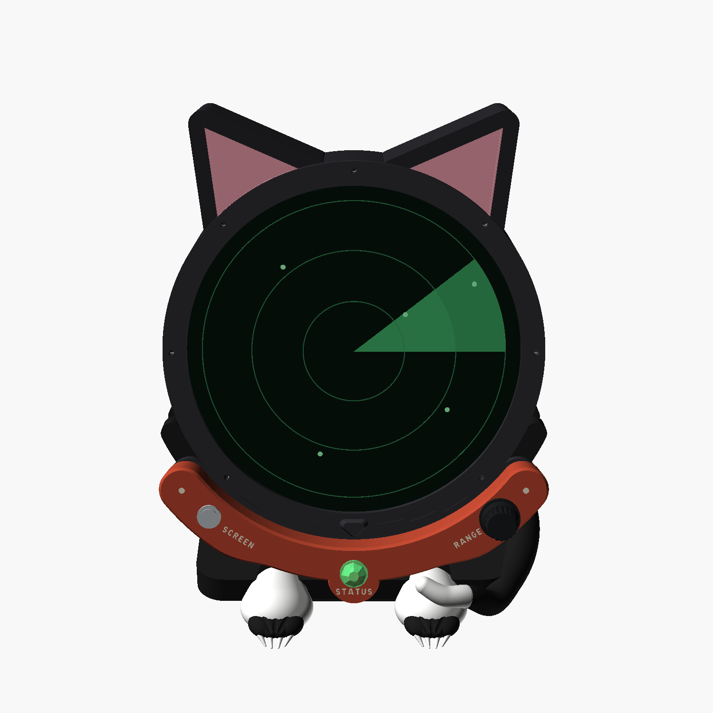
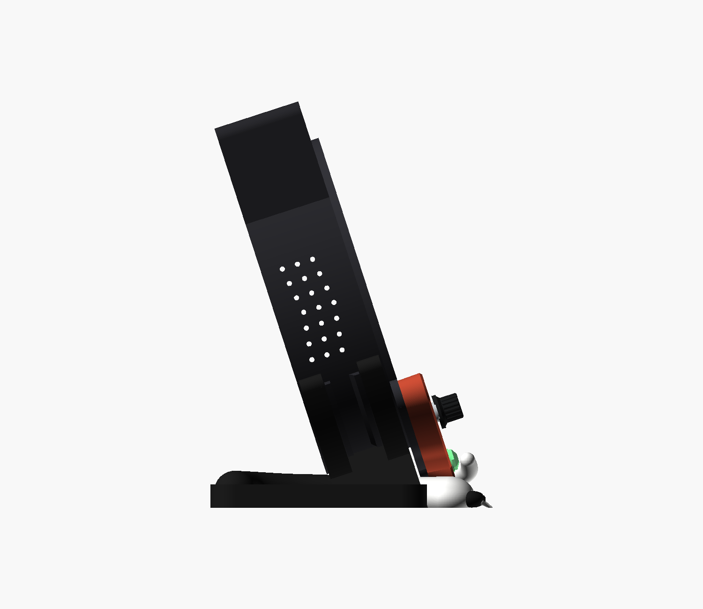
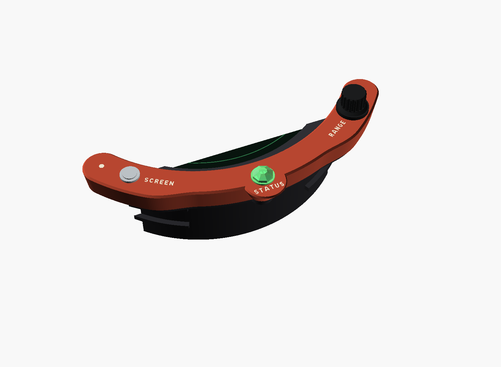
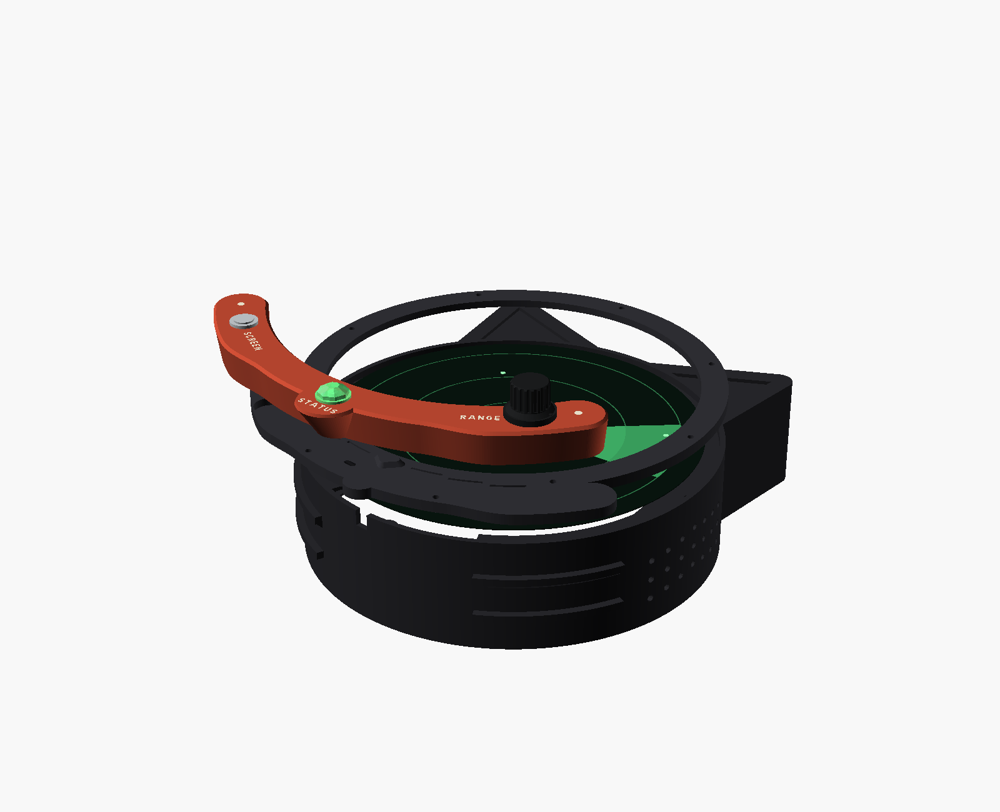
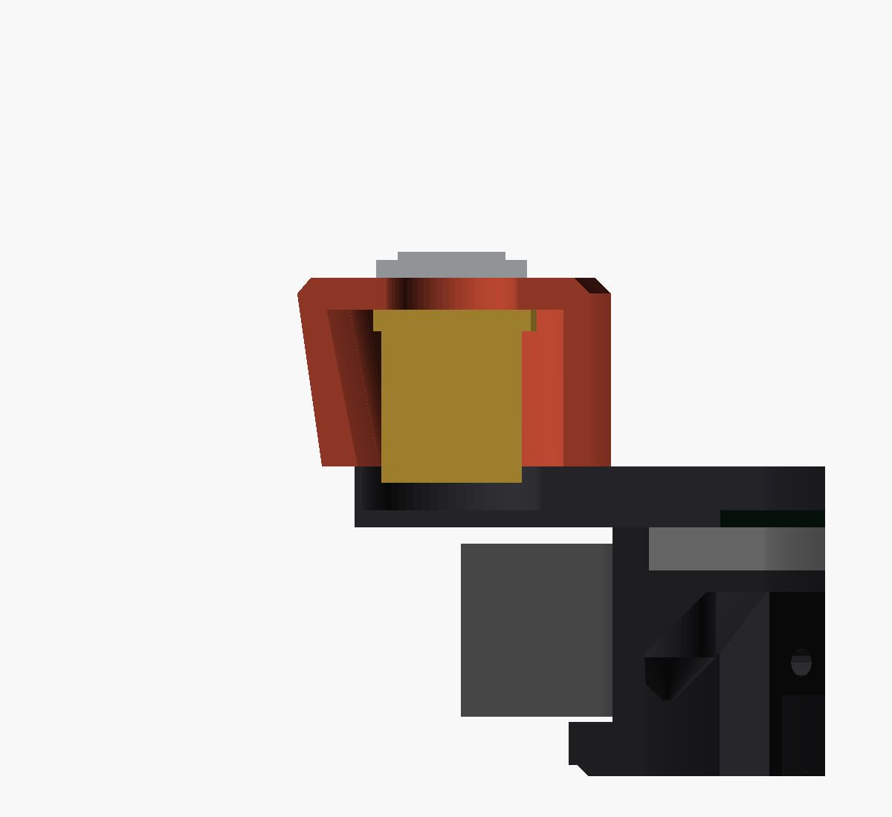
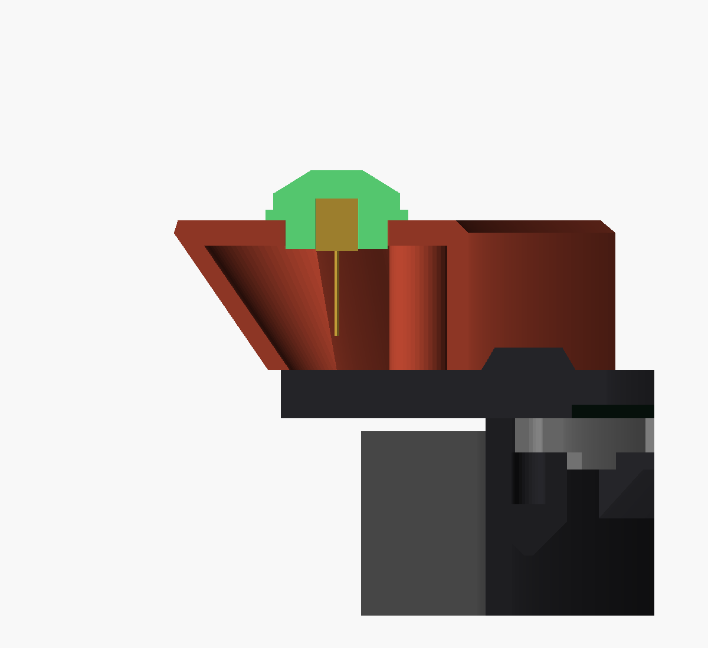
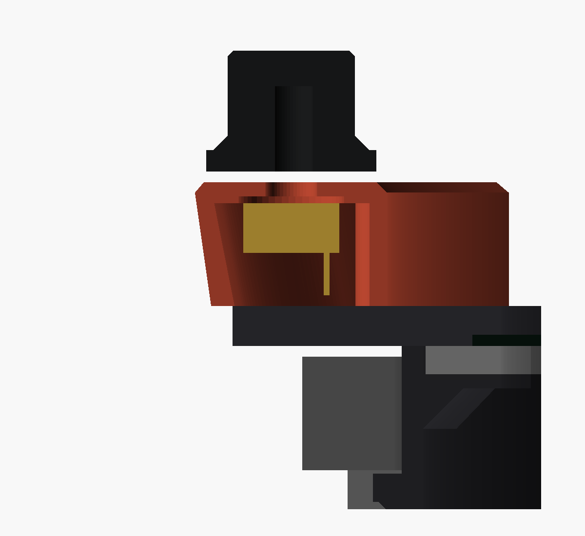

# Kitten with Dials

The kitten case wearing a collar under its chin, with the Retro with Dials'
three controls set in it (2026-11-01):

| Control | Where | What it does |
|---|---|---|
| **SCREEN** button | left cheek | A press turns the screen on or off. Holding it for 2 s switches between "sleeps when idle" and "always on". |
| **STATUS** jewel lamp | on the collar's tag, under the chin | Green while the radar hears aircraft. Amber when the receiver has gone deaf. Red when the power supply is dipping. |
| **RANGE** dial | right cheek | Turning it zooms the radar out or in; pinch still works. Pushing it returns to the home view. |

Everything except the collar is the kitten case, unchanged:
`kitten-dials.scad` includes
`../Kitten Enclosure Two-Tone/kitten-enclosure-twotone.scad`. The controls,
their sizes, the knob and the lens are the Retro with Dials' own
(`../Retro Radar with Dials/dial-controls.scad`, which both cases include),
and so are the wiring and the software. Print the retainer, back plate,
antenna mount, the power fix's parts and the stand from the kitten folder.
The head comes in one colour or, as the kitten's does, with the centres of
its ears in a second colour ([Print](#print)).

| Front | From a desk chair | Side | The collar | Exploded |
|---|---|---|---|---|
|  |  |  |  |  |

## Why the collar hangs from the face

The Retro with Dials' arc screws to the drum's wall from inside. Under the
kitten's chin nothing can: the stand's cradle wraps the bottom 130° of the
head, its front arm 1 mm off the wall from 17.5 mm to 1.5 mm behind the
shell's front edge, with the keel filling the middle 46° behind it; and
either side of the cradle the speakers' sleeves fill the wall inside. So
the collar stands in front of the cradle, and the front trim carries it:

- the trim grows a **flange** under the chin, in its own plane and its full
  thickness, 1.5 mm in front of the cradle's arm. The flange is the
  collar's back and its cover;
- the collar stands on the flange, and two M3 countersunk screws come
  through the flange from behind into heat-set inserts in two columns in
  the collar;
- the wires go down a 45° channel through the flange and a slot in the
  shell's front edge, in the shelf's gap at the bottom, into the case below
  the retainer. That slot is the only change to the shell.

The trim is the kitten's own part, not a shared one, and its seven screws
hold the collar too. The stand is the kitten's, unchanged: the head still
drops into its cradle, and the collar comes no nearer the stand than 3 mm.

The collar runs from the left cheek to the right one, about 116° of the
head's outline. The button and the knob sit on the cheeks, beyond the paws,
where the knob is clear of the paws and the tail; the lamp sits on a round
tag hanging between the paws. Over the paws the band's lower edge comes in
by 6 mm, easing in and out over 15°, so from the front the collar's outline
stops above the raised paw's toes and the tag hangs alone between the paws;
the collar clears the stand by 8 mm and the desk by 10. The face's inner
and outer edges and the tag's rim are chamfered 1.5 mm at 45°, so it reads
as something worn, not a plate on the face. The words for SCREEN and RANGE
stand beside their controls, along the band, not under them: the knob's
24 mm skirt fills the band's width. STATUS is on the tag, under the jewel.

## Print

| File | What | Notes |
|---|---|---|
| `kitten-head-dials-twotone.3mf` | The head with the wires' slot, its inner ears in a second colour | Replaces `kitten-head-twotone.3mf`: `shell_head_dials` on filament 1 and `shell_inner_ears` on filament 2. Print it as the [kitten's two-colour head](../Kitten%20Enclosure%20Two-Tone/README.md#the-inner-ears-in-a-second-colour); the slot, under the chin, is nowhere near the ears and changes nothing in how it prints. |
| `shell_head_dials.stl`, `shell_inner_ears.stl` | The same as separate meshes | `shell_inner_ears.stl` is the kitten folder's file, exported here unchanged so the 3MF's builder finds it. |
| `shell_dials.stl` | The head in one colour, with the slot | Replaces `shell.stl`. Print it the same way, in ASA. |
| `front_trim_dials.stl` | The kitten's trim with the collar's flange | Replaces `front_trim.stl`. Face up, rabbet and flange on the bed, as the kitten's trim prints, with support under the inner band only ([the kitten's README](../Kitten%20Enclosure%20Two-Tone/README.md#the-trim-prints-face-up)). The flange's countersinks open on the bed at 45°, its wire channel leans at 45° and the button's pocket opens upward, so none of them needs support. |
| `collar_twotone.3mf` | The collar, with its lettering and two studs in a second colour | Face down, no support. The inlay is the first 0.6 mm. Use the [two-colour settings](../Retro%20Radar%20with%20Dials/README.md#lettering-in-two-colours-print-settings), and print the coupon first. |
| `test_lettering_collar.3mf` | A two-colour test coupon: a 1.2 mm slice of the collar's face round each word, with its lettering | About 5 minutes, face down. |
| `collar.stl`, `collar_text.stl` | The collar and its inlay as separate meshes | For a printer without two colours. |
| `test_lettering_collar.stl`, `test_lettering_collar_text.stl` | The coupon as separate meshes | |
| `../Retro Radar with Dials/knob.stl` | The RANGE knob | The Retro with Dials' file: the same knob. Skirt down, ASA or PETG. |
| `../Retro Radar with Dials/jewel_lens.stl` | The STATUS lamp's lens | The Retro with Dials' file: the same lens. Clear or translucent PETG, shank down. |

The collar is 228 mm across and fits a 256 mm bed: it slices on an X1C
profile. The trim with its flange is 223 x 247 mm, also under 256, but
Bambu Studio would not place it on the X1C profile ("no object is fully
inside the print volume"), most likely because of that profile's excluded
corner (18 x 28 mm, front left); it places on the H2D.

Sliced in Bambu Studio 2.08's command line on 2026-11-01 (0.20 mm Standard,
Bambu ASA, tree supports at 30°). The figures are approximate: they move by
a minute or two and a gram or so with where the part sits on the plate.

| File | Profile | Support | Time | Filament |
|---|---|---|---|---|
| `collar_twotone.3mf` | X1C, with the [two-colour settings](../Retro%20Radar%20with%20Dials/README.md#lettering-in-two-colours-print-settings) | none | about 1 h | about 29 g + 0.7 g |
| `test_lettering_collar.3mf` | X1C, the same settings | none | about 5 min | about 1.6 g |
| `collar.stl` | X1C, Standard | none | about 1 h | about 29 g |
| `front_trim_dials.stl` | H2D, Standard | 1.7 cm³, all under the inner band, as the kitten's trim | about 1 h 25 min | about 39 g |
| `kitten-head-dials-twotone.3mf` | — | — | — | — |

The head's two-colour file isn't sliced here: the H2D profile's command
line crashes on any two-filament file, and the head is too tall for the X1C
profile. It is the kitten's two-colour head less a 7.5 mm slot, so expect
the [kitten's figures](../Kitten%20Enclosure%20Two-Tone/README.md#the-inner-ears-in-a-second-colour)
(about 8 h 20 min, 196 g and 3.5 g, on the H2D); open it in the desktop
app to confirm.

## Buy

The [Retro with Dials' buy list](../Retro%20Radar%20with%20Dials/README.md#buy):
the encoder, the button, the LED and its resistors, the wire and the
header housings, the same parts. Only these differ:

- **Screws:** 2 × M3 x 10 countersunk, from behind the flange into the
  collar's columns, with 2 × M3 x 5 heat-set inserts. No M2.5 cover screws:
  the flange is the collar's cover.
- **The button's depth:** the same rule, no more than 16 mm behind the
  panel, tags included. Behind the collar's face there is 14.5 mm to the
  flange, and the flange's 4 mm pocket behind the button makes it 18.5;
  2 mm of that is for the wires to turn off the tags. The common 21 mm
  button runs into the pocket's floor.
- **Wire:** eight thin wires, about 35 cm each, go through the flange's
  7 x 3 mm channel, two rows of four.

## Wire

Exactly as the [Retro with Dials](../Retro%20Radar%20with%20Dials/README.md#wire):
every control switches to ground on the Pi's internal pull-ups, on the same
pins (encoder A, B and push on GPIO 17, 27 and 22; SCREEN on GPIO 23; the
LED's red, green and blue on GPIO 12, 13 and 18 through 220 Ω), and the
same caveat about the FlyCatcher over the header applies. Join the four
grounds inside the collar, so eight wires go through. Turn the controls on
the same way: `sudo sh deploy/install-setup-server.sh` with `CONTROLS=1`, or
write `{"enabled": true}` to `/etc/stratoscan/controls.json` and restart
`stratoscan-controls`.

## Assemble

The collar goes onto the trim, and the trim goes on last, as on the kitten
case.

1. Press the shell's heat-set inserts in, as for the kitten case, and the
   two M3 inserts into the collar's columns from the back.
2. Fit the encoder, the button and the lens through the collar's face. The
   encoder's nut goes on from the front, under the knob.
3. Solder the wires, with the LED's resistors inline under heat-shrink, and
   join the grounds, so eight wires leave the collar. Leave their far ends
   bare: no header housings yet.
4. Feed the wires through the flange's channel from the front, lay the
   collar on the flange, and drive the two M3 x 10 countersunk screws from
   behind the flange. Their heads sit flush in the flange's back.
5. Build the head as for the kitten case: speakers, retainer, display.
6. Put the trim on, laying the wires into the slot in the shell's front
   edge under the chin, so they drop into the case below the retainer, and
   screw the trim down with its seven screws.
7. With the back plate off, crimp the female housings onto the wires now
   that they are through the channel and the slot (a housing won't pass
   the 3 mm channel), plug them onto the header, push the knob onto the
   encoder shaft, and turn the controls on (above).

To take the trim off later, pull the knob off first: its skirt stands
within 9 mm of the trim screw at 315° (lower right), and a driver can't
reach that screw past it.

Work on the back with the head in its stand. The collar stands 17.5 mm
proud of the face and the knob 36 mm, so the head can't lie face down on a
flat bench.

## The sections

Each is cut on the plane through the case's axis and one control, the face
up, the head's inside to the right. The bought part behind the face is in
gold, the stand's front arm in grey.

| SCREEN | STATUS | RANGE |
|---|---|---|
|  |  |  |

The button's body reaches into the flange's pocket, 1.6 mm short of its
back; the lamp's LED and leads and the encoder's body and pins stay inside
the collar. All three are 1.5 mm and more in front of the cradle's arm. The
encoder's square body bears on the face's back at its corners: its 19 mm
diagonal is wider than the face's 15 mm round relief, which only thins the
face round the bushing so the nut reaches, as on the Retro with Dials.

## Checks

`sh run-checks.sh` runs the fit checks in `checks.scad`; each measures
volume, as the other cases' checks do. They check that:

- the collar and the trim touch only face to face, the collar stays 2 mm
  off the trim's rim and clear of the nose, and the flange fills none of the
  whisker grooves and leaves the trim's seven screw holes open;
- the flange closes the collar's cavity, and over the paws, where both come
  in, none of the flange shows past the collar;
- in the stand, nothing the collar adds meets the stand; the collar clears
  it by 8 mm and the trim by 3 mm, and both the desk by 10 mm; the head
  still sits in the cradle; and the cradle's arm ends where the design says
  (`z_arm_front`);
- the button, encoder and lamp fit inside the collar and the flange's
  pocket, clear the wires' channel, and the common 21 mm button does not
  fit;
- the wires' way is open, down the flange's channel, down the shell's slot
  and into the case below the retainer;
- the screws pass the flange into the inserts and their heads seat flush;
- the lettering keeps 1 mm inside the face's flat (inside the chamfers), 1 mm clear of the
  controls and the studs, and its words 2 mm apart, and the controls stay
  over the face.

Each has a positive control that proves its probe is near enough to bite
(the collar 10 mm lower and the trim 6 mm lower meet the stand, the desk
15 mm lower, the 21 mm button, a flange 0.5 mm smaller leaves the cavity
open, the old full-width flange shows past the collar, the probes moved
sideways, and so on). `python3 tests/test_enclosure_core.py` holds
this folder as a variant of the kitten: it includes the kitten's design and
redefines none of its parts, its print files match the design, its 3MFs
hold their STLs, and its lettering's strokes and gaps are measured with the
rest (check 13).

`sh render-views.sh` remakes the pictures in `images/`.
`python3 make-collar-3mf.py` remakes the two-colour files, after exporting
`collar.stl`, `collar_text.stl`, `test_lettering_collar.stl`,
`test_lettering_collar_text.stl`, `shell_head_dials.stl` and
`shell_inner_ears.stl` as binary STL (`dpart` `collar_print`,
`collar_text_print`, `coupon_print`, `coupon_text_print`,
`shell_head_dials` and `shell_inner_ears`).

## Still to measure or decide

- **The stand's fit, on a printed stand.** The collar clears the stand by
  8 mm in the design, the trim's flange by 3 mm. Seat the head in a printed stand with the collar on
  and look at the gap under the tag and over the paws before trusting it.
- **The wires past the display's ribbon.** The slot drops the wires into
  the shelf's gap at the bottom, where the display's driver board and its
  cabling also are, between the retainer's key and the bottom front post.
  Check on a built unit that eight wires fit past them.
- **The button.** As for the Retro with Dials: 16 mm deep or less behind
  the panel, tags included, its nut no more than 16 mm across. The checks
  take it as a 16 mm round 16 mm deep, as the arc's do.
- **The colour.** The pictures show a red collar on a black head with pink
  inner ears. Any colours work; the collar, its lettering and the ears are
  separate prints, so each can be any filament.
