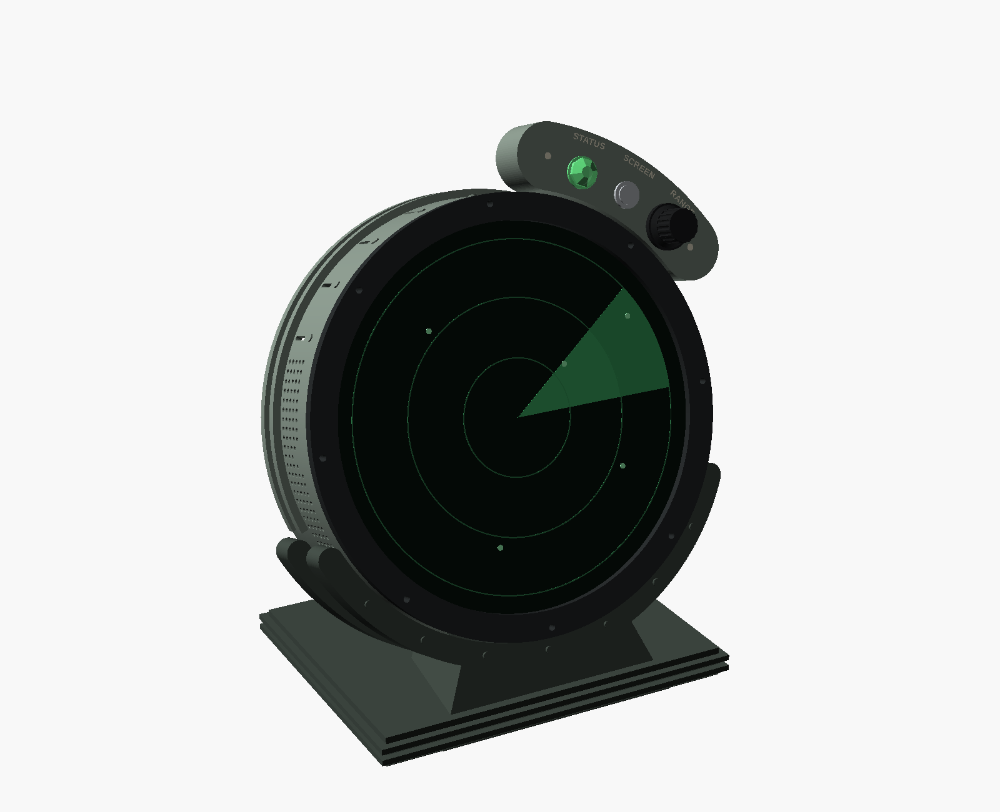
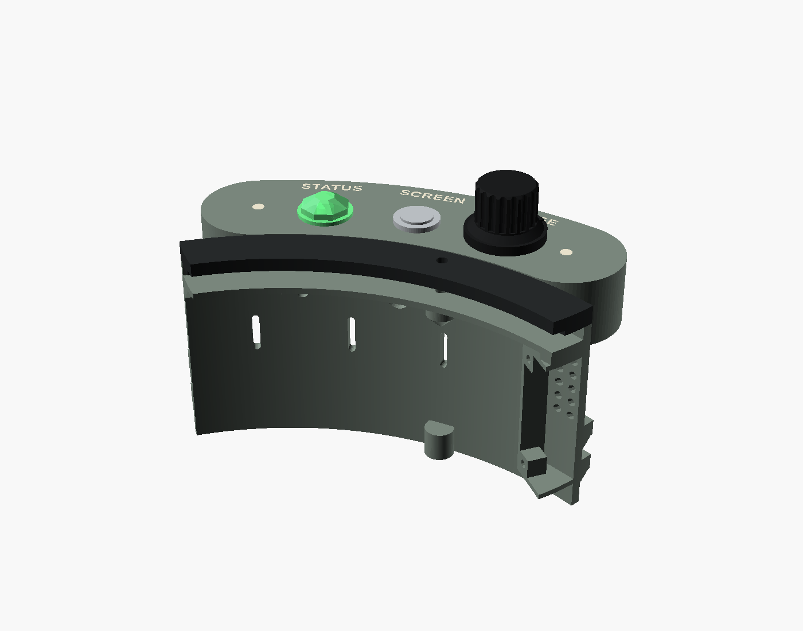
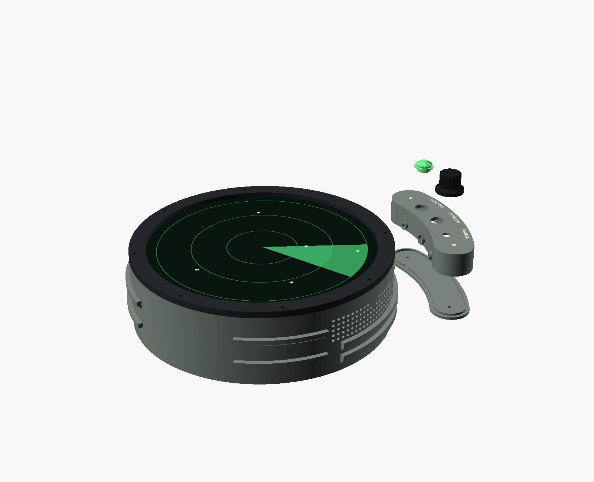

# Retro Radar with Dials

The retro radar case with a control arc on its upper right. The arc carries
three controls:

| Control | What it does |
|---|---|
| **STATUS** jewel lamp | Green while the radar hears aircraft. Amber when the receiver has gone deaf. Red when the power supply is dipping. |
| **SCREEN** button | A press turns the screen on or off. Holding it for 2 s switches between "sleeps when idle" and "always on". |
| **RANGE** dial | Turning it zooms the radar out or in; pinch still works. Pushing it returns to the home view. |

Everything except the arc is the retro case, unchanged:
`retro-dials.scad` includes `../Retro Radar Enclosure/retro-enclosure.scad`.
The shell gains three holes through its wall: two screws and a wire hole.
Print the front trim, retainer, back plate, antenna mount and stand from the
retro folder, and the power fix's parts with them: `power_trigger_mount`,
the `power_trigger_stop`s and `power_regulator_tray`. For the back plate's
charger label in a second colour, print its `back_plate_twotone.3mf`.

| Front | The arc | Exploded |
|---|---|---|
|  |  |  |

## Print

| File | What | Notes |
|---|---|---|
| `shell_dials.stl` | The retro shell with the arc's three holes | Replaces `shell.stl`. Print it the same way, in ASA. |
| `control_arc_twotone.3mf` | The arc, with its lettering and two rivet dots in a second colour | Face down, no support. The lettering is the first 0.6 mm, so there is one filament change per layer for three layers. Use the [two-colour settings](#lettering-in-two-colours-print-settings), and print the coupon first. |
| `test_lettering_arc.3mf` | A two-colour test coupon: a 1.2 mm slice of the arc's face round each word, with its lettering | About 12 minutes, face down. Tune the slicer on this before the arc. |
| `test_lettering_arc.stl`, `test_lettering_arc_text.stl` | The coupon and its lettering as separate meshes | |
| `control_arc.stl`, `control_arc_text.stl` | The same arc and lettering as separate meshes | For a printer without two colours: print `control_arc.stl` and paint the lettering. |
| `control_arc_cover.stl` | The flat cover that closes the arc's back | Flat side down. |
| `knob.stl` | The RANGE knob, for a 6 mm D shaft | Skirt down. Print it in ASA or PETG. |
| `jewel_lens.stl` | The STATUS lamp's faceted lens | Clear or translucent PETG, shank down. A drop of glue holds it. |

The arc's face is 1 mm behind the trim's face (2026-10-29), so the arc
reads as a part bolted to the case rather than a bulge in the trim. Its
depth used to be worked out from the panel's whole 6.45 mm depth rather than
the 1.62 mm glass, which stood the face 3.9 mm proud of the trim. The arc is
4.9 mm shallower now, 21.1 mm, so the SCREEN button behind its face has to
be a short one ([Buy](#buy)). Its neck, where the wires pass, and the hole
through it are teardrops, so it needs no support face down. Sliced in Bambu
Studio 2.08 (X1C 0.4, 0.20 mm Standard, ASA, tree supports at 30°), the
two-colour arc's support went from 0.3 cm³ to none, its print from 0.84 to
0.71 h and its filament from 23.2 to 20.0 g. The cover, knob, lens and
lettering are unchanged; `shell_dials.stl` changes with the retro shell, as
it did on 2026-10-29 (its shelf slope, speaker sleeves, front rail,
rivets and grille holes: see the retro case's README).

## Lettering in two colours: print settings

The back plate's charger label, the twin antenna covers' frequencies and the
Retro with Dials' control arc are inlaid in a second colour, and each part
prints face down, so its letters are its first three layers (2026-10-31).
The first two-colour arc printed with broken letters: SCREEN's C almost gone,
STATUS's S half there, and a pale ring round each word. Its strokes were
0.5 mm wide, about one first-layer line, and Bambu Studio's default classic
walls leave out a stroke too narrow for two of them. Sliced with the
defaults, the old lettering's first layer is thin and patchy in its narrow
strokes, the C and S among them. What caused the pale ring is not yet known;
print a coupon (below) to see whether these settings cure it.

Two things changed. The lettering is larger and bolder, with every stroke at
least 1.0 mm wide and every counter and gap between letters at least 0.8 mm
open (`tests/test_enclosure_core.py` measures them, check 13). And the first
three settings below go on the part, set by hand once the 3MF is open:
Arachne walls, elephant-foot compensation 0 and a monotonic line bottom
surface. For a few hours on 2026-10-31 the 3MFs carried them as per-object
settings, but Bambu Studio's desktop app then opened the files as geometry
only ("The 3mf file has invalid config"), losing the filaments, so the 3MFs
now hold only the parts and their filaments, with the face at z 0, on the
bed. Sliced with the settings, the first layer now lays two lines or more
across most of each stroke, and one wider Arachne line, up to 0.7 mm, across
most of the rest. Arachne walls and the larger lettering are what fill the
first layer.

**Print a coupon first.** `test_lettering_plate.3mf` and
`test_lettering_cover.3mf` (in the Retro and Kitten folders) and
`test_lettering_arc.3mf` (Retro with Dials) are 1.2 mm slices of the faces
round their lettering, cut from the parts themselves. Each prints in about
11 to 12 minutes on an X1C, against 25 minutes for a cover, 52 for the arc
and 2 h 40 min for the plate. When a coupon's letters come out whole with
clean edges, its part will too.

The settings, with their names in Bambu Studio 2.08 and the keys in its own
profiles. Set the first three on the object (right-click it in the object
list, then Process, and add them under Quality and Strength) or, with only
the face on the plate, in the print settings; the 3MF does not set them.

| Setting | Where | Value | Key | Who sets it |
|---|---|---|---|---|
| Wall generator | Quality | Arachne | `wall_generator` | you, per object or for the plate |
| Elephant foot compensation | Quality > Precision | 0: keeps the face's outer edge from being pulled in 0.15 mm; it does not touch the lettering | `elefant_foot_compensation` | you, per object or for the plate |
| Bottom surface pattern | Strength | Monotonic line | `bottom_surface_pattern` = `monotonicline` | you, per object or for the plate |
| First layer line width | Quality > Line width | 0.42 mm | `initial_layer_line_width` | you, in the print settings |
| First layer speed, and first layer infill | Speed | 30 to 40 mm/s | `initial_layer_speed`, `initial_layer_infill_speed` | you, in the print settings |
| Prime tower | Others | on (the default) | `enable_prime_tower` | you, in the print settings |
| Z-hop | Printer > Extruder | 0.4 mm, Auto Lift (the X1C's default) | `z_hop`, `z_hop_types`; a filament can override it with `filament_z_hop` | the printer |
| Plate | the plate's type | Smooth PEI ("Smooth PEI Plate / High Temp Plate"), clean, preferred over the Engineering plate for a face | `curr_bed_type` | you |
| Filament | | dry ASA: 65 °C for 12 h, or 80 °C for 8 h where the dryer allows it (Bambu's ASA profile) | | you |

What slicing with Bambu Studio 2.08's command line showed:

- Bambu Studio honours the first three settings per object. With Arachne
  alone, the old cover's first layer laid down much more of its lettering.
- Elephant-foot compensation acts only on a part's outside edge, not on the
  edge the two colours share. Sliced with it at 0.15 and at 0, the
  lettering's first layer came out the same, and only the face's outline
  grew 0.15 mm a side. It is off so the face's edge prints true.
- Set per object, first-layer line width and speed did nothing. They work
  only as print settings, so set them there.
- A first-layer width of 0.42 instead of 0.5 hardly changed the coverage:
  90 to 94% either way. It lays a third line in more of the wider strokes,
  at the cost of more short lines under 0.4 mm. Arachne's walls do the
  work.
- The slow first layer and the Z-hop keep the nozzle from catching the
  first layer's edges. The gouge beside the SCREEN hole on the first arc
  looks like that kind of drag. Wet ASA strings and blobs on those travels.
- The prime tower takes each colour change's purge, three changes on the
  way up and one back to filament 1, off the part.

The arc's lettering was 3.3 mm until 2026-10-31. It is 5.6 mm now, each
stroke fattened 0.11 mm a side: strokes 1.04 mm, narrowest gap 0.87 mm.
At that size the three words no longer fit centred on their controls,
12.5° apart, so STATUS stands 2.4° beyond its lamp and RANGE 2° short of
its knob, still over them, with about 3.5 mm between the words. The checks
`labels_on_face`, `labels_clear_of_controls` and `labels_apart` hold that.

## Buy

| Part | Qty | Notes |
|---|---|---|
| EC11 rotary encoder with push switch, 20 mm D shaft (6 mm), M7 bushing | 1 | Snap off its small locating tab, or the face will not let it sit flat. |
| 12 mm momentary push button, normally open, metal, flat cap, **no more than 16 mm deep behind the panel, tags included** | 1 | A short-body one: behind the arc's face there is 18 mm to the cover, and 2 mm of that is for the wires to turn off the tags. The common 21 mm button runs into the cover. Not a latching switch: alerts and the idle timer also turn the screen on and off, so a switch that stays down would often point the wrong way. |
| 5 mm RGB LED, common cathode, diffused | 1 | Diffused looks better behind the lens. |
| 220 Ω resistors | 3 | One in each colour leg of the LED. |
| M3 x 10 screws | 2 | From inside the case, into the arc's pads. |
| M3 x 5 heat-set inserts | 2 | The same inserts as the rest of the case. |
| M2.5 x 8 countersunk self-tapping screws | 2 | They hold the cover. |
| Thin hook-up wire (26–28 AWG), or an 8-way ribbon, about 30 cm | 1 | Eight wires go through the 7 mm hole. |
| Female jumper housings for the Pi's header, and heat-shrink | — | To plug onto the GPIO pins. |

## Wire

Every control switches to ground, using the Pi's internal pull-ups, so no
other parts are needed apart from the LED's resistors. Use the Pi 5's 40-pin
header; the numbers are physical pin numbers.

| From | To | Pin |
|---|---|---|
| Encoder A | GPIO 17 | 11 |
| Encoder B | GPIO 27 | 13 |
| Encoder common (C) | Ground | 9 |
| Encoder push switch | GPIO 22 | 15 |
| Encoder push switch, other leg | Ground | 14 |
| SCREEN button | GPIO 23 | 16 |
| SCREEN button, other leg | Ground | 20 |
| LED red, through 220 Ω | GPIO 12 | 32 |
| LED green, through 220 Ω | GPIO 13 | 33 |
| LED blue, through 220 Ω | GPIO 18 | 12 |
| LED common cathode | Ground | 34 |

These pins leave I2C (GPIO 2 and 3) free for the light sensor (roadmap 5.5),
and the UART (GPIO 14 and 15) free for the presence sensor (5.2).

**The FlyCatcher sits over the header.** If its board covers the pins you need,
take them out from beside it with a short ribbon to a breakout. Don't fit a
2 × 20 stacking header under the FlyCatcher: it lifts the board about 8.5 mm
toward the back plate, and the case leaves the FlyCatcher's switches only
10.2 mm from the plate (`hat_stack`, measured on the first unit, 2026-10-29),
so a header would leave 1.7 mm, less than the 2 mm the case needs; that was
what pushed the shell from 56 to 61 mm deep. Use one only on a unit whose
switches stand 10.5 mm or more from the plate.

**The wiring route is still open (2026-10-30).** The jumpers pushed onto
the pins under the FlyCatcher, with the back plate off (Assemble, step 6),
are the route for now. Two things are not settled: how much room there is
between the Pi's header and the FlyCatcher for jumper housings, which has
yet to be measured on a built unit, and whether a keyed 8-way connector
just inside the wall would be better, so the arc's wires unplug in one
piece and can't go back on the wrong pins. Both wait on that measurement.

## Assemble

The arc, its wires and its cover go onto the empty shell, before the display
(2026-10-29). The arc's two M3 screws go in sideways from inside the case,
12 mm behind the shell's front, so they need the shell empty: once the
display is in, there is no room for a screwdriver there.

1. Press the shell's heat-set inserts in, as for the retro case, and the two
   M3 inserts into the arc's pads from the drum side.
2. Fit the encoder, the button and the lens through the arc's face. The
   encoder's nut goes on from the front, under the knob.
3. Solder the wires, with the LED's resistors inline under heat-shrink. Join
   the four grounds (the encoder's common, the other leg of each switch and
   the LED's cathode) inside the arc, so eight wires go through: seven
   signals and one ground, to any of the ground pins in the table. Pass them
   through the arc's neck and the case wall, and screw the cover on.
4. Hold the arc against the empty shell and drive the two M3 x 10 screws
   from inside.
5. Then build the rest of the case as for the retro case: speakers,
   retainer, display and trim, with the wires left hanging inside, clear of
   the speakers.
6. With the back plate off, plug the wires onto the header, push the knob
   onto the encoder shaft, and turn the controls on:
   `sudo sh deploy/install-setup-server.sh` with `CONTROLS=1`, or write
   `{"enabled": true}` to `/etc/stratoscan/controls.json` and restart
   `stratoscan-controls`.

Work on the back with the case in its stand, or face down on a ring at least
25 mm tall under the trim. The encoder's shaft alone stands 17 mm proud of
the trim's face, and the knob on it up to 22 mm, so the case can't lie face
down on a flat bench.

## Checks

`sh run-checks.sh` runs 30 fit checks; each measures volume, as the retro
case's checks do. They check that:

- the arc clears the shell, front trim, stand, side vents and speaker grille;
- the arc's face is 0.5-1.5 mm behind the trim's face, and `z_trim_face` is
  where the trim's face really is, as `front_stack_placed()` puts it;
- the screw heads and wires clear the posts and shelf inside the case;
- the button, encoder and lamp fit behind the face and clear the cover, and
  the common 21 mm button does not;
- the pads really land on the drum, the holes are really open, and the
  lettering is present;
- the lettering keeps 1 mm inside the face's edge, 1 mm clear of the lamp,
  the button, the knob's skirt and the rivet dots, and its words 2 mm
  apart, each with a control that proves its probe is near enough to bite
  (`labels_near_edge`, `labels_near_controls`, `labels_near_each_other`).

`sh render-views.sh` remakes the pictures in `images/`.
`python3 make-arc-3mf.py` remakes the two-colour files, after exporting
`control_arc.stl`, `control_arc_text.stl`, `test_lettering_arc.stl` and
`test_lettering_arc_text.stl` as binary STL (`dpart` `pod_print`,
`pod_text_print`, `coupon_print` and `coupon_text_print`).
`tests/test_enclosure_core.py` (check 12) fails while a 3MF no longer holds
its STLs, or lacks its slicer settings.

## Design references

The arc follows a general practice of radar consoles from the 1940s to the 1970s:

- controls set beside the round scope;
- a small indicator lamp;
- rivets;
- plain engraved labels.

Each of these is functional and generic, so the design copies no particular
product's shape, knob, panel layout, badge, name or typeface. One arc is used
rather than a pod on each shoulder, because two round pods on the upper
shoulders of a round drum would make a well-known three-circle silhouette. The
photographs below were consulted and are linked here, not copied:

- [Decca radar display unit](https://collection.sciencemuseumgroup.org.uk/objects/co55824/decca-display-unit), Science Museum Group
- [Philips SGR radar console](https://commons.wikimedia.org/wiki/File:Philips_SGR_radar_1.JPG), Wikimedia Commons, public domain
- [WSR-57 weather radar console](https://commons.wikimedia.org/wiki/File:WSR-57_Weather_Radar_Console_-_51167475916.jpg), Wikimedia Commons, CC BY 2.0
- [US Navy SG radar console, 1945](https://commons.wikimedia.org/wiki/File:SG_Radar_Console_1945.jpg), Wikimedia Commons, public domain
- [RCAF radar display unit](https://collection.ingenium.ca/en/id/1968.0935.001), Ingenium
